# Bike parking at Guelph's strip-mall plazas

*Survey of OpenStreetMap data, 2026-09-05. Prepared for bike advocacy use.*

## Summary

Guelph has **66 open-air plazas** in OpenStreetMap (plus 2 enclosed malls, listed at the end). Of those 66:

| Verdict | Plazas |
|---|---|
| ✅ Has bike parking on site | 26 |
| 🟡 Nearby only (a rack within 100 m, but not on the property) | 13 |
| ❌ None mapped | 27 |

Across all plazas, 58 bike parking locations are mapped. Most have no capacity recorded, so the number of bikes they hold is unknown.

**How to read "none mapped".** OpenStreetMap is a volunteer map. A plaza with no bike rack in the map may still have one on the ground that nobody has recorded yet. Treat ❌ as "go and look", not as "there is no rack". A plaza marked ✅ has been confirmed by at least one mapper, but the rack may be a poor one (a wheel-bender or a single wall loop). Where the rack type is known it is listed under the plaza.

**What counts as a plaza here.** Open-air, multi-tenant retail with shared surface parking, with at least four named businesses mapped. That includes the big-box power centres (SmartCentres, Woodlawn Square, Clairfield Commons, Pergola Commons). It excludes enclosed malls (listed separately), single-tenant buildings, downtown main-street storefronts and the university's pedestrian plazas. Plazas with no name in the map are listed by street and house-number range with their first three tenants.

**How to fix the map.** Every plaza links to its OpenStreetMap entry. Anyone can add a missing rack: open the link, click Edit, and add a point tagged `amenity=bicycle_parking` with the rack type and capacity. That keeps this report accurate for the next person who runs it.

Companion files: `plazas.csv` (one row per plaza, for your own map), `img/` (screenshots), `analyze.py` and `render.py` (how this was produced).

## All plazas at a glance

| Plaza | Verdict | Racks | Capacity | Tenants | Map |
|---|---|---|---|---|---|
| [Campus Estates Plaza](#campus-estates-plaza) | ❌ none mapped |  |  | 17 | [OSM](https://www.openstreetmap.org/way/208650724) |
| [Clair Marketplace](#clair-marketplace) | 🟡 nearby only |  |  | 19 | [OSM](https://www.openstreetmap.org/way/556632268) |
| [Clairfield Commons](#clairfield-commons) | 🟡 nearby only |  |  | 12 | [OSM](https://www.openstreetmap.org/way/217504192) |
| [Edinburgh Market Place](#edinburgh-market-place) | ✅ has parking | 3 | 18 + 1 rack untagged | 16 | [OSM](https://www.openstreetmap.org/way/833377075) |
| [Grange & Victoria Plaza](#grange-victoria-plaza) | ✅ has parking | 1 | 8 | 6 | [OSM](https://www.openstreetmap.org/way/332330004) |
| [Hartsland Market Square](#hartsland-market-square) | ❌ none mapped |  |  | 13 | [OSM](https://www.openstreetmap.org/way/197749304) |
| [Kortright Plaza](#kortright-plaza) | ❌ none mapped |  |  | 4 | [OSM](https://www.openstreetmap.org/way/197805877) |
| [Melran Mall](#melran-mall) | ❌ none mapped |  |  | 25 | [OSM](https://www.openstreetmap.org/way/344325628) |
| [Pergola Commons](#pergola-commons) | ✅ has parking | 4 | 1 + 3 racks untagged | 23 | [OSM](https://www.openstreetmap.org/way/287908722) |
| [Scottsdale Centre](#scottsdale-centre) | ❌ none mapped |  |  | 7 | [OSM](https://www.openstreetmap.org/way/354160042) |
| [Silvercreek Business Centre](#silvercreek-business-centre) | 🟡 nearby only |  |  | 12 | [OSM](https://www.openstreetmap.org/way/773015480) |
| [Silvercreek Plaza](#silvercreek-plaza) | ✅ has parking | 6 | 6 racks untagged | 21 | [OSM](https://www.openstreetmap.org/way/256118290) |
| [Silverwood Plaza](#silverwood-plaza) | ❌ none mapped |  |  | 10 | [OSM](https://www.openstreetmap.org/way/773015486) |
| [SmartCentres Guelph](#smartcentres-guelph) | ✅ has parking | 2 | 2 + 1 rack untagged | 24 | [OSM](https://www.openstreetmap.org/way/772928911) |
| [South City Centre](#south-city-centre) | ❌ none mapped |  |  | 0 | [OSM](https://www.openstreetmap.org/way/215069449) |
| [Speedvale Centre](#speedvale-centre) | ❌ none mapped |  |  | 28 | [OSM](https://www.openstreetmap.org/way/237319873) |
| [Stone Square Plaza](#stone-square-plaza) | ✅ has parking | 4 | 21 | 20 | [OSM](https://www.openstreetmap.org/way/208406209) |
| [Stonegate Plaza](#stonegate-plaza) | ❌ none mapped |  |  | 12 | [OSM](https://www.openstreetmap.org/way/212559744) |
| [Sugarbush Plaza](#sugarbush-plaza) | ❌ none mapped |  |  | 4 | [OSM](https://www.openstreetmap.org/way/993366503) |
| [University Square Plaza](#university-square-plaza) | ✅ has parking | 2 | 4 | 13 | [OSM](https://www.openstreetmap.org/way/399321881) |
| [10-20 Woodlawn Road East (unnamed)](#10-20-woodlawn-road-east-unnamed) | ✅ has parking | 1 | 2 | 8 | [OSM](https://www.openstreetmap.org/way/239062267) |
| [1027 Gordon Street (unnamed)](#1027-gordon-street-unnamed) | 🟡 nearby only |  |  | 9 | [OSM](https://www.openstreetmap.org/way/773000852) |
| [104 Silvercreek Parkway North (unnamed)](#104-silvercreek-parkway-north-unnamed) | ✅ has parking | 1 | 3 | 7 | [OSM](https://www.openstreetmap.org/way/295926707) |
| [105 Silvercreek Parkway North (unnamed)](#105-silvercreek-parkway-north-unnamed) | 🟡 nearby only |  |  | 5 | [OSM](https://www.openstreetmap.org/way/295926658) |
| [127-201 Stone Road West (unnamed)](#127-201-stone-road-west-unnamed) | ✅ has parking | 3 | 24 | 6 | [OSM](https://www.openstreetmap.org/way/215068137) |
| [1388-1398 Gordon Street (unnamed)](#1388-1398-gordon-street-unnamed) | ❌ none mapped |  |  | 8 | [OSM](https://www.openstreetmap.org/way/192887202) |
| [1499-1515 Gordon Street (unnamed)](#1499-1515-gordon-street-unnamed) | ✅ has parking | 1 | 2 | 14 | [OSM](https://www.openstreetmap.org/way/399342895) |
| [159 Fife Road (unnamed)](#159-fife-road-unnamed) | ❌ none mapped |  |  | 4 | [OSM](https://www.openstreetmap.org/way/773030532) |
| [170 Silvercreek Parkway North (unnamed)](#170-silvercreek-parkway-north-unnamed) | ✅ has parking | 2 | 2 racks untagged | 8 | [OSM](https://www.openstreetmap.org/way/971832743) |
| [188-196 Waterloo Avenue (unnamed)](#188-196-waterloo-avenue-unnamed) | ❌ none mapped |  |  | 4 | [OSM](https://www.openstreetmap.org/way/772999948) |
| [200-206 Silvercreek Parkway North (unnamed)](#200-206-silvercreek-parkway-north-unnamed) | 🟡 nearby only |  |  | 8 | [OSM](https://www.openstreetmap.org/way/295926125) |
| [200-234 Victoria Road South (unnamed)](#200-234-victoria-road-south-unnamed) | ✅ has parking | 2 | 2 racks untagged | 13 | [OSM](https://www.openstreetmap.org/way/539479797) |
| [204 Yorkshire Street North (unnamed)](#204-yorkshire-street-north-unnamed) | ❌ none mapped |  |  | 4 | [OSM](https://www.openstreetmap.org/way/772951791) |
| [208-222 Silvercreek Parkway North (unnamed)](#208-222-silvercreek-parkway-north-unnamed) | ✅ has parking | 1 | 5 | 15 | [OSM](https://www.openstreetmap.org/way/295926200) |
| [21-35 Woodlawn Road West (unnamed)](#21-35-woodlawn-road-west-unnamed) | ✅ has parking | 1 | 1 rack untagged | 5 | [OSM](https://www.openstreetmap.org/way/772928910) |
| [221-223 Woodlawn Road West (unnamed)](#221-223-woodlawn-road-west-unnamed) | 🟡 nearby only |  |  | 16 | [OSM](https://www.openstreetmap.org/way/773015473) |
| [241-249 Edinburgh Road North (unnamed)](#241-249-edinburgh-road-north-unnamed) | ❌ none mapped |  |  | 4 | [OSM](https://www.openstreetmap.org/way/772950211) |
| [252 Silvercreek Parkway North (unnamed)](#252-silvercreek-parkway-north-unnamed) | 🟡 nearby only |  |  | 9 | [OSM](https://www.openstreetmap.org/way/773015485) |
| [265-297 Eramosa Road (unnamed)](#265-297-eramosa-road-unnamed) | ✅ has parking | 1 | 1 rack untagged | 6 | [OSM](https://www.openstreetmap.org/way/772911628) |
| [292-314 Stone Road West (unnamed)](#292-314-stone-road-west-unnamed) | 🟡 nearby only |  |  | 26 | [OSM](https://www.openstreetmap.org/way/369321286) |
| [320 Eastview Road (unnamed)](#320-eastview-road-unnamed) | ❌ none mapped |  |  | 8 | [OSM](https://www.openstreetmap.org/way/358488660) |
| [340 Woodlawn Road West (unnamed)](#340-woodlawn-road-west-unnamed) | ❌ none mapped |  |  | 13 | [OSM](https://www.openstreetmap.org/way/399149070) |
| [380 Eramosa Road (unnamed)](#380-eramosa-road-unnamed) | ❌ none mapped |  |  | 9 | [OSM](https://www.openstreetmap.org/way/772911624) |
| [4-124 Clair Road East (unnamed)](#4-124-clair-road-east-unnamed) | ✅ has parking | 7 | 7 racks untagged | 24 | [OSM](https://www.openstreetmap.org/way/399319859) |
| [415-429 Woodlawn Road West (unnamed)](#415-429-woodlawn-road-west-unnamed) | ❌ none mapped |  |  | 4 | [OSM](https://www.openstreetmap.org/way/399149099) |
| [450 Woodlawn Road West (unnamed)](#450-woodlawn-road-west-unnamed) | ❌ none mapped |  |  | 4 | [OSM](https://www.openstreetmap.org/way/773016985) |
| [465-565 Woodlawn Road West (unnamed)](#465-565-woodlawn-road-west-unnamed) | ❌ none mapped |  |  | 6 | [OSM](https://www.openstreetmap.org/way/962456073) |
| [486 Woodlawn Road East (unnamed)](#486-woodlawn-road-east-unnamed) | ❌ none mapped |  |  | 5 | [OSM](https://www.openstreetmap.org/way/772926644) |
| [50 Wellington Street East (unnamed)](#50-wellington-street-east-unnamed) | 🟡 nearby only |  |  | 4 | [OSM](https://www.openstreetmap.org/way/772999958) |
| [51-55 Woodlawn Road West (unnamed)](#51-55-woodlawn-road-west-unnamed) | ✅ has parking | 1 | 2 | 4 | [OSM](https://www.openstreetmap.org/way/772928908) |
| [617-649 Scottsdale Drive (unnamed)](#617-649-scottsdale-drive-unnamed) | ❌ none mapped |  |  | 4 | [OSM](https://www.openstreetmap.org/way/468349503) |
| [630-650 Scottsdale Drive (unnamed)](#630-650-scottsdale-drive-unnamed) | ❌ none mapped |  |  | 8 | [OSM](https://www.openstreetmap.org/way/468349505) |
| [666 Woolwich Street (unnamed)](#666-woolwich-street-unnamed) | ❌ none mapped |  |  | 11 | [OSM](https://www.openstreetmap.org/way/772928901) |
| [670-698 Woolwich Street (unnamed)](#670-698-woolwich-street-unnamed) | ✅ has parking | 4 | 4 + 3 racks untagged | 10 | [OSM](https://www.openstreetmap.org/way/772928904) |
| [715 Wellington Street West (unnamed)](#715-wellington-street-west-unnamed) | ✅ has parking | 1 | 1 rack untagged | 10 | [OSM](https://www.openstreetmap.org/way/364715613) |
| [727-777 Woolwich Street (unnamed)](#727-777-woolwich-street-unnamed) | 🟡 nearby only |  |  | 15 | [OSM](https://www.openstreetmap.org/way/772928906) |
| [75 Willow Road (unnamed)](#75-willow-road-unnamed) | ❌ none mapped |  |  | 10 | [OSM](https://www.openstreetmap.org/way/773014769) |
| [86-100 Gordon Street (unnamed)](#86-100-gordon-street-unnamed) | ✅ has parking | 1 | 8 | 26 | [OSM](https://www.openstreetmap.org/way/772999957) |
| [89-105 Gordon Street (unnamed)](#89-105-gordon-street-unnamed) | ✅ has parking | 2 | 4 + 1 rack untagged | 7 | [OSM](https://www.openstreetmap.org/way/328207036) |
| [926 Paisley Road (unnamed)](#926-paisley-road-unnamed) | 🟡 nearby only |  |  | 5 | [OSM](https://www.openstreetmap.org/way/256252178) |
| [951 Gordon Street (unnamed)](#951-gordon-street-unnamed) | 🟡 nearby only |  |  | 10 | [OSM](https://www.openstreetmap.org/way/399321888) |
| [Wellington Plaza](#wellington-plaza) | ✅ has parking | 1 | 8 | 10 | [OSM](https://www.openstreetmap.org/way/177697922) |
| [West Hills Plaza](#west-hills-plaza) | ✅ has parking | 4 | 4 racks untagged | 19 | [OSM](https://www.openstreetmap.org/way/256252221) |
| [Westwood Plaza](#westwood-plaza) | ✅ has parking | 1 | 1 rack untagged | 10 | [OSM](https://www.openstreetmap.org/way/1192488955) |
| [Willow West](#willow-west) | ✅ has parking | 1 | 1 rack untagged | 13 | [OSM](https://www.openstreetmap.org/way/208496000) |
| [Woodlawn Square](#woodlawn-square) | ❌ none mapped |  |  | 8 | [OSM](https://www.openstreetmap.org/way/773015474) |

## Plazas with no bike parking mapped

These are the priority list. Distance is from the edge of the plaza to the nearest mapped rack anywhere in the city.

| Plaza | Nearest mapped rack | Tenants |
|---|---|---|
| [Speedvale Centre](#speedvale-centre) | 852 m | 28 |
| [Melran Mall](#melran-mall) | 873 m | 25 |
| [Campus Estates Plaza](#campus-estates-plaza) | 167 m | 17 |
| [Hartsland Market Square](#hartsland-market-square) | 449 m | 13 |
| [340 Woodlawn Road West (unnamed)](#340-woodlawn-road-west-unnamed) | 864 m | 13 |
| [Stonegate Plaza](#stonegate-plaza) | 128 m | 12 |
| [666 Woolwich Street (unnamed)](#666-woolwich-street-unnamed) | 175 m | 11 |
| [Silverwood Plaza](#silverwood-plaza) | 508 m | 10 |
| [75 Willow Road (unnamed)](#75-willow-road-unnamed) | 128 m | 10 |
| [380 Eramosa Road (unnamed)](#380-eramosa-road-unnamed) | 128 m | 9 |
| [1388-1398 Gordon Street (unnamed)](#1388-1398-gordon-street-unnamed) | 179 m | 8 |
| [320 Eastview Road (unnamed)](#320-eastview-road-unnamed) | 1589 m | 8 |
| [630-650 Scottsdale Drive (unnamed)](#630-650-scottsdale-drive-unnamed) | 115 m | 8 |
| [Woodlawn Square](#woodlawn-square) | 230 m | 8 |
| [Scottsdale Centre](#scottsdale-centre) | 159 m | 7 |
| [465-565 Woodlawn Road West (unnamed)](#465-565-woodlawn-road-west-unnamed) | 1166 m | 6 |
| [486 Woodlawn Road East (unnamed)](#486-woodlawn-road-east-unnamed) | 1623 m | 5 |
| [Kortright Plaza](#kortright-plaza) | 406 m | 4 |
| [Sugarbush Plaza](#sugarbush-plaza) | 356 m | 4 |
| [159 Fife Road (unnamed)](#159-fife-road-unnamed) | 1010 m | 4 |
| [188-196 Waterloo Avenue (unnamed)](#188-196-waterloo-avenue-unnamed) | 310 m | 4 |
| [204 Yorkshire Street North (unnamed)](#204-yorkshire-street-north-unnamed) | 142 m | 4 |
| [241-249 Edinburgh Road North (unnamed)](#241-249-edinburgh-road-north-unnamed) | 255 m | 4 |
| [415-429 Woodlawn Road West (unnamed)](#415-429-woodlawn-road-west-unnamed) | 1119 m | 4 |
| [450 Woodlawn Road West (unnamed)](#450-woodlawn-road-west-unnamed) | 1039 m | 4 |
| [617-649 Scottsdale Drive (unnamed)](#617-649-scottsdale-drive-unnamed) | 193 m | 4 |
| [South City Centre](#south-city-centre) | 192 m | 0 |

## Plaza by plaza

Blue outline: the plaza as drawn in OpenStreetMap. Green circles: bike parking counted for this plaza (on the property or within 30 m of its edge). Grey circle: the nearest rack when there is none on site. Map tiles are the OpenStreetMap Standard layer.

### Campus Estates Plaza

**❌ none mapped**  ·  [OpenStreetMap](https://www.openstreetmap.org/way/208650724)  ·  [map view](https://www.openstreetmap.org/#map=18/43.52480/-80.22241)  ·  2.8 ha  ·  17 tenants mapped

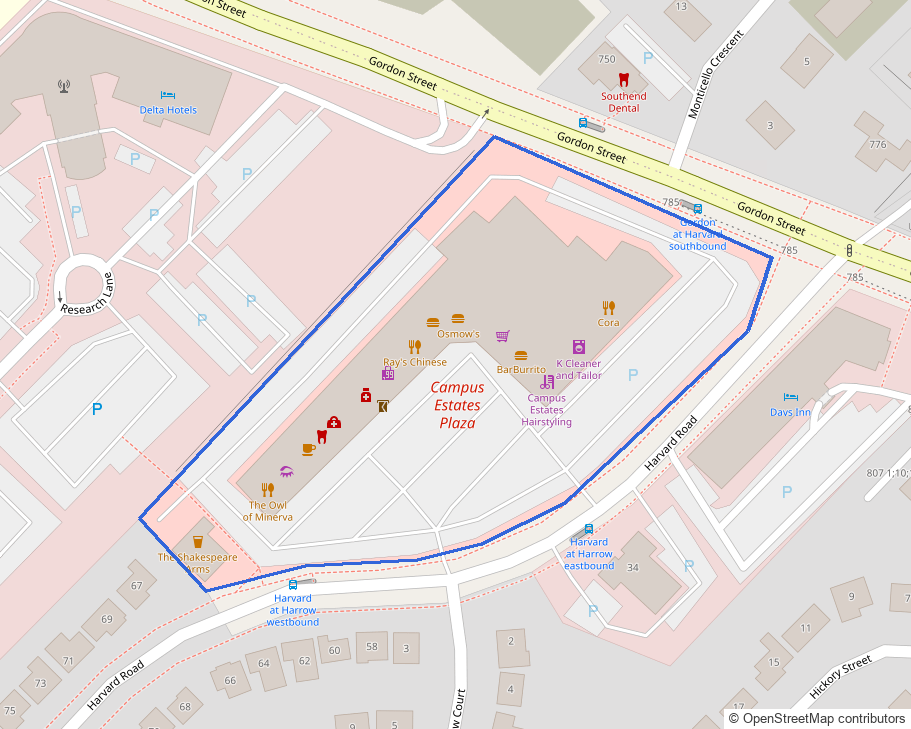

No bike parking mapped on the property. Nearest mapped rack is 167 m away ([node 13062612120](https://www.openstreetmap.org/node/13062612120)).

### Clair Marketplace

**🟡 nearby only**  ·  [OpenStreetMap](https://www.openstreetmap.org/way/556632268)  ·  [map view](https://www.openstreetmap.org/#map=18/43.49894/-80.18921)  ·  3.3 ha  ·  19 tenants mapped

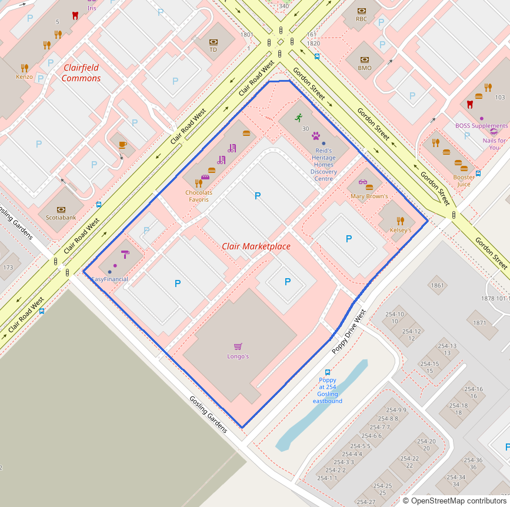

No bike parking mapped on the property. Nearest mapped rack is 78 m away ([node 12823796244](https://www.openstreetmap.org/node/12823796244)).

### Clairfield Commons

**🟡 nearby only**  ·  [OpenStreetMap](https://www.openstreetmap.org/way/217504192)  ·  [map view](https://www.openstreetmap.org/#map=18/43.50012/-80.19081)  ·  3.0 ha  ·  12 tenants mapped

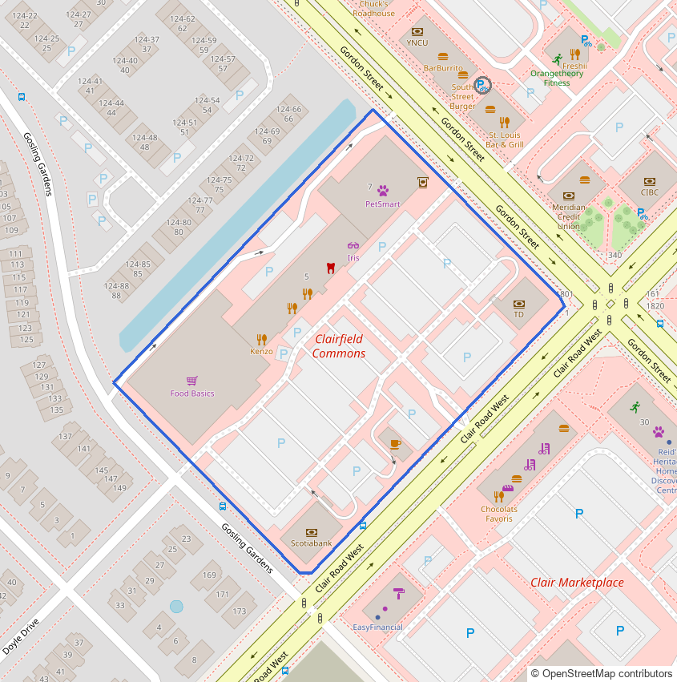

No bike parking mapped on the property. Nearest mapped rack is 51 m away ([node 12823720971](https://www.openstreetmap.org/node/12823720971)).

### Edinburgh Market Place

**✅ has parking**  ·  [OpenStreetMap](https://www.openstreetmap.org/way/833377075)  ·  [map view](https://www.openstreetmap.org/#map=18/43.52134/-80.23407)  ·  4.0 ha  ·  16 tenants mapped

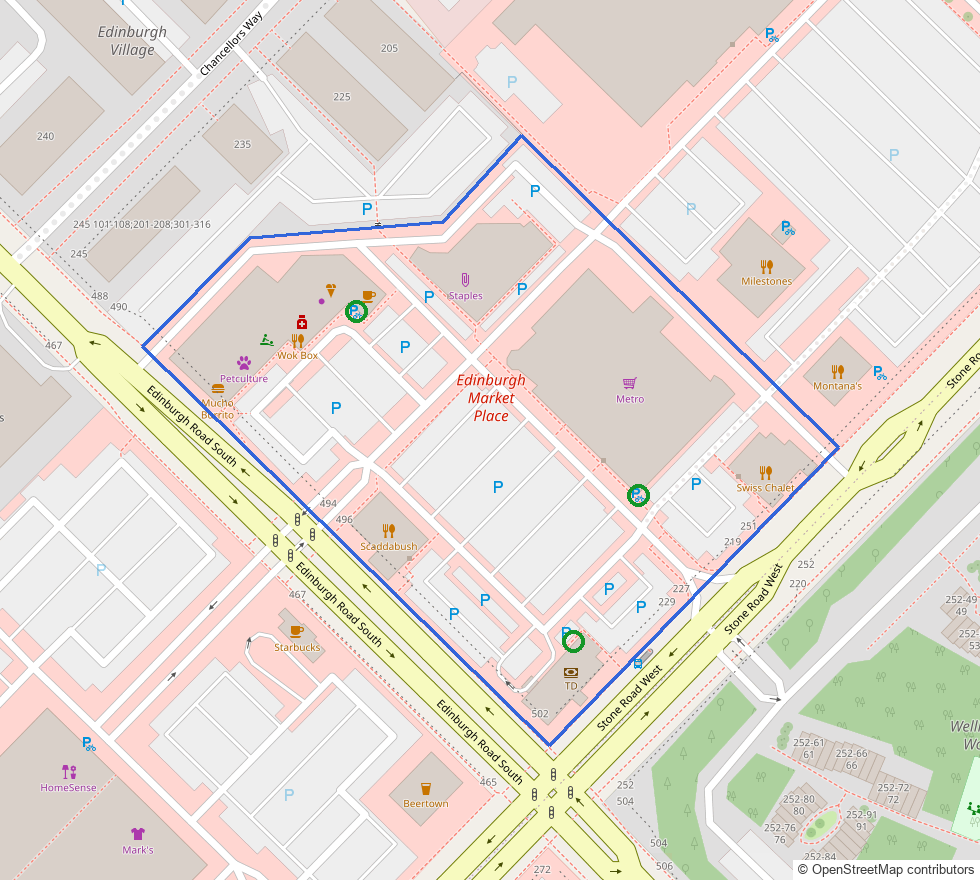

Bike parking found:

- [node 12335509795](https://www.openstreetmap.org/node/12335509795): wall_loops, capacity 10
- [node 12335525353](https://www.openstreetmap.org/node/12335525353): stands
- [node 13963396495](https://www.openstreetmap.org/node/13963396495): stands, capacity 8

### Grange & Victoria Plaza

**✅ has parking**  ·  [OpenStreetMap](https://www.openstreetmap.org/way/332330004)  ·  [map view](https://www.openstreetmap.org/#map=18/43.55759/-80.23015)  ·  3.4 ha  ·  6 tenants mapped

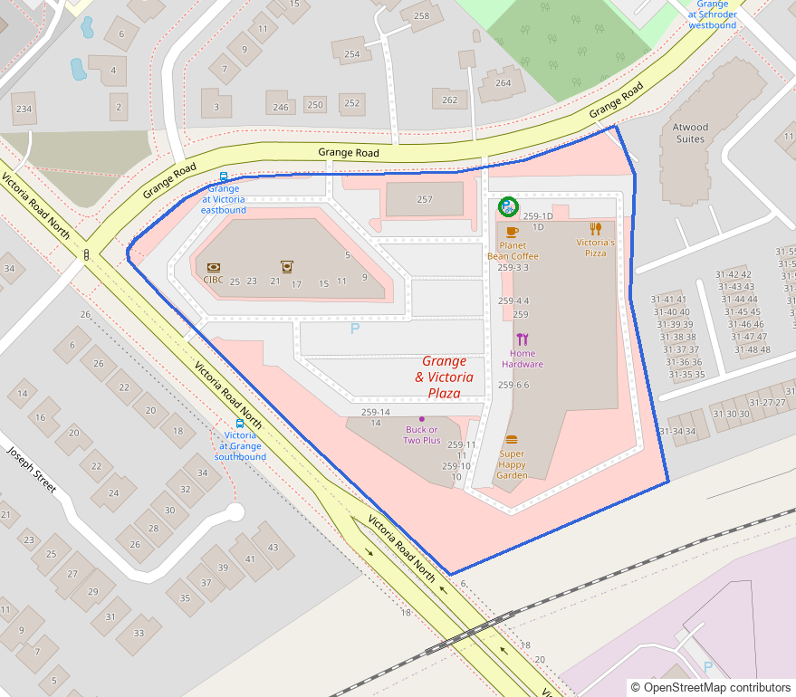

Bike parking found:

- [node 12530496793](https://www.openstreetmap.org/node/12530496793): stands, capacity 8

### Hartsland Market Square

**❌ none mapped**  ·  [OpenStreetMap](https://www.openstreetmap.org/way/197749304)  ·  [map view](https://www.openstreetmap.org/#map=18/43.51341/-80.21919)  ·  4.6 ha  ·  13 tenants mapped

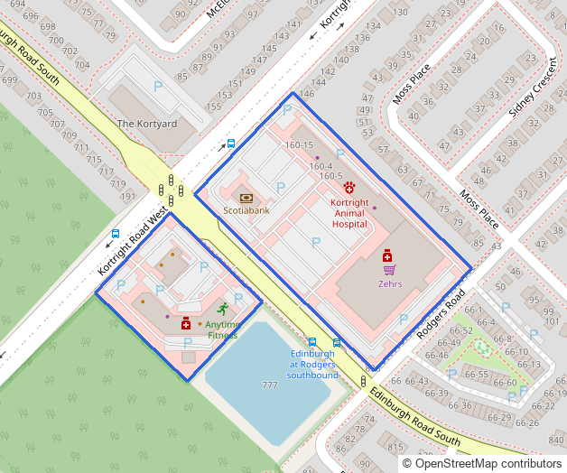

No bike parking mapped on the property. Nearest mapped rack is 449 m away ([node 14139961003](https://www.openstreetmap.org/node/14139961003)).

### Kortright Plaza

**❌ none mapped**  ·  [OpenStreetMap](https://www.openstreetmap.org/way/197805877)  ·  [map view](https://www.openstreetmap.org/#map=18/43.50844/-80.23088)  ·  0.8 ha  ·  4 tenants mapped

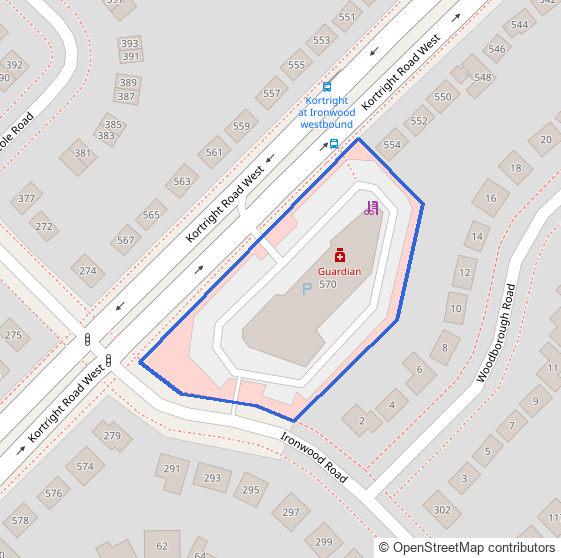

No bike parking mapped on the property. Nearest mapped rack is 406 m away ([node 14139961003](https://www.openstreetmap.org/node/14139961003)).

### Melran Mall

**❌ none mapped**  ·  [OpenStreetMap](https://www.openstreetmap.org/way/344325628)  ·  [map view](https://www.openstreetmap.org/#map=18/43.53403/-80.30526)  ·  1.0 ha  ·  25 tenants mapped

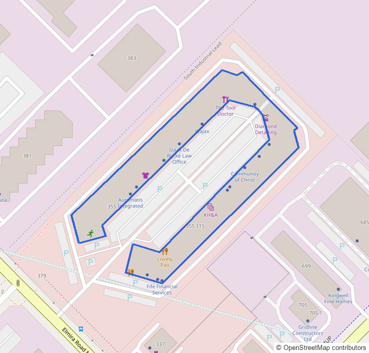

No bike parking mapped on the property. Nearest mapped rack is 873 m away ([node 12798111182](https://www.openstreetmap.org/node/12798111182)).

### Pergola Commons

**✅ has parking**  ·  [OpenStreetMap](https://www.openstreetmap.org/way/287908722)  ·  [map view](https://www.openstreetmap.org/#map=18/43.50098/-80.18651)  ·  5.4 ha  ·  23 tenants mapped

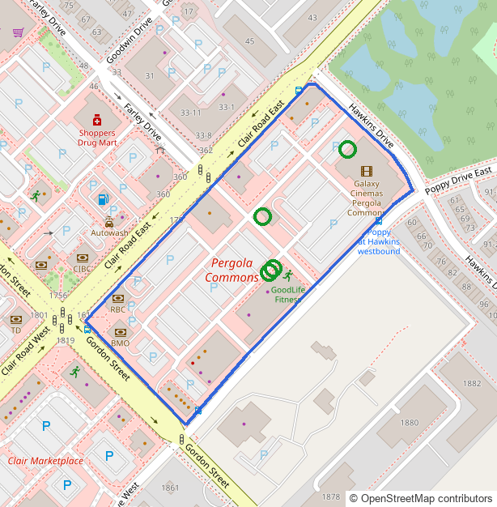

Bike parking found:

- [node 9768470959](https://www.openstreetmap.org/node/9768470959): bollard
- [node 11479641171](https://www.openstreetmap.org/node/11479641171): stands
- [node 11479926870](https://www.openstreetmap.org/node/11479926870): type not tagged
- [node 13233440059](https://www.openstreetmap.org/node/13233440059): stands, capacity 1

### Scottsdale Centre

**❌ none mapped**  ·  [OpenStreetMap](https://www.openstreetmap.org/way/354160042)  ·  [map view](https://www.openstreetmap.org/#map=18/43.51479/-80.23761)  ·  0.2 ha  ·  7 tenants mapped

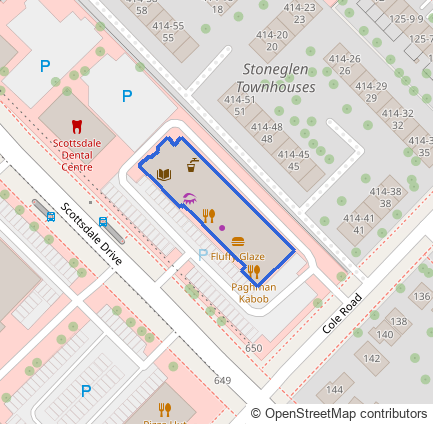

No bike parking mapped on the property. Nearest mapped rack is 159 m away ([node 11225402345](https://www.openstreetmap.org/node/11225402345)).

### Silvercreek Business Centre

**🟡 nearby only**  ·  [OpenStreetMap](https://www.openstreetmap.org/way/773015480)  ·  [map view](https://www.openstreetmap.org/#map=18/43.54469/-80.28549)  ·  2.1 ha  ·  12 tenants mapped

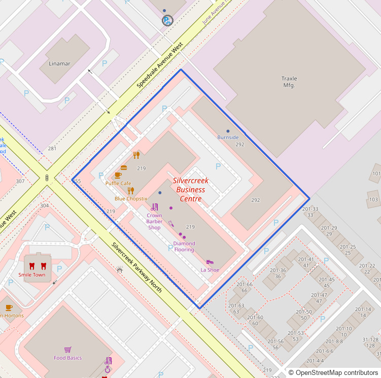

No bike parking mapped on the property. Nearest mapped rack is 43 m away ([node 12564637269](https://www.openstreetmap.org/node/12564637269)).

### Silvercreek Plaza

**✅ has parking**  ·  [OpenStreetMap](https://www.openstreetmap.org/way/256118290)  ·  [map view](https://www.openstreetmap.org/#map=18/43.53964/-80.28122)  ·  2.2 ha  ·  21 tenants mapped

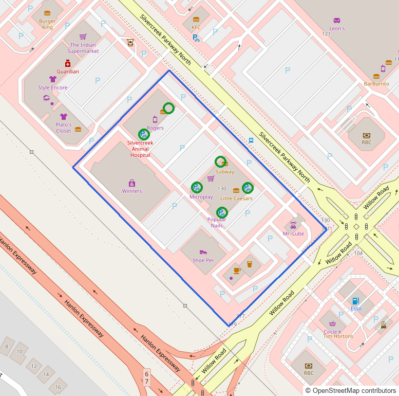

Bike parking found:

- [node 9789312723](https://www.openstreetmap.org/node/9789312723): bollard
- [node 9789312724](https://www.openstreetmap.org/node/9789312724): stands
- [node 9789312725](https://www.openstreetmap.org/node/9789312725): bollard
- [node 9789312726](https://www.openstreetmap.org/node/9789312726): stands
- [node 9789312727](https://www.openstreetmap.org/node/9789312727): type not tagged
- [node 9789312728](https://www.openstreetmap.org/node/9789312728): bollard

### Silverwood Plaza

**❌ none mapped**  ·  [OpenStreetMap](https://www.openstreetmap.org/way/773015486)  ·  [map view](https://www.openstreetmap.org/#map=18/43.55115/-80.29502)  ·  1.1 ha  ·  10 tenants mapped

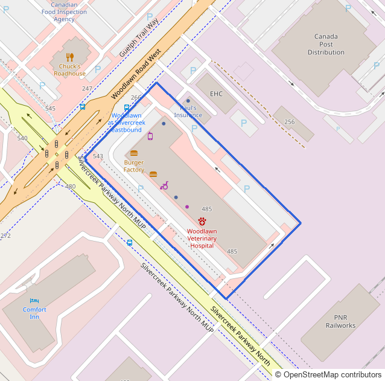

No bike parking mapped on the property. Nearest mapped rack is 508 m away ([node 13233491582](https://www.openstreetmap.org/node/13233491582)).

### SmartCentres Guelph

**✅ has parking**  ·  [OpenStreetMap](https://www.openstreetmap.org/way/772928911)  ·  [map view](https://www.openstreetmap.org/#map=18/43.56480/-80.28106)  ·  12.3 ha  ·  24 tenants mapped

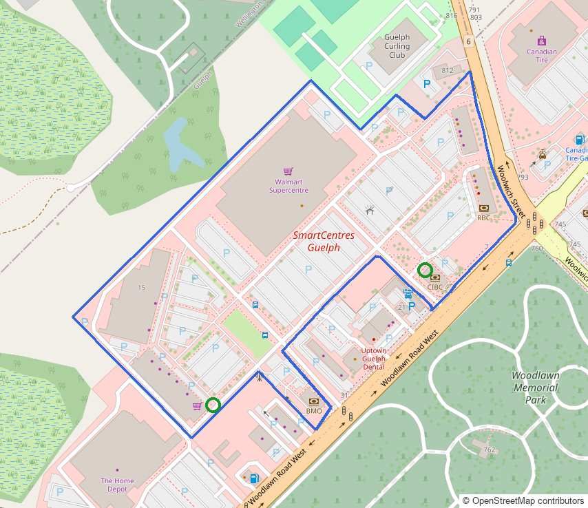

Bike parking found:

- [node 12713893391](https://www.openstreetmap.org/node/12713893391): stands
- [node 13027046604](https://www.openstreetmap.org/node/13027046604): stands, capacity 2

### South City Centre

**❌ none mapped**  ·  [OpenStreetMap](https://www.openstreetmap.org/way/215069449)  ·  [map view](https://www.openstreetmap.org/#map=18/43.51868/-80.23321)  ·  0.0 ha  ·  0 tenants mapped

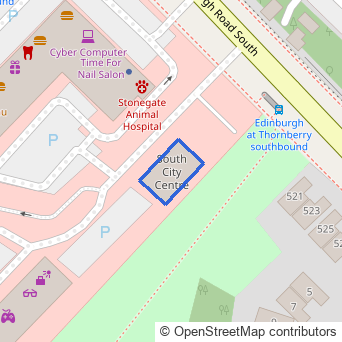

No bike parking mapped on the property. Nearest mapped rack is 192 m away ([node 13963396495](https://www.openstreetmap.org/node/13963396495)).

### Speedvale Centre

**❌ none mapped**  ·  [OpenStreetMap](https://www.openstreetmap.org/way/237319873)  ·  [map view](https://www.openstreetmap.org/#map=18/43.56742/-80.25805)  ·  3.8 ha  ·  28 tenants mapped

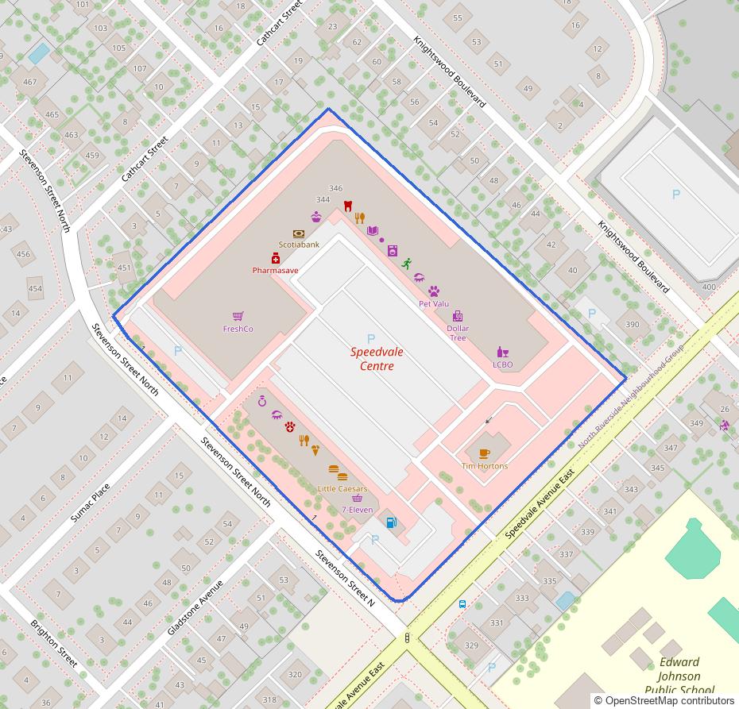

No bike parking mapped on the property. Nearest mapped rack is 852 m away ([node 9768470960](https://www.openstreetmap.org/node/9768470960)).

### Stone Square Plaza

**✅ has parking**  ·  [OpenStreetMap](https://www.openstreetmap.org/way/208406209)  ·  [map view](https://www.openstreetmap.org/#map=18/43.51681/-80.23649)  ·  3.4 ha  ·  20 tenants mapped

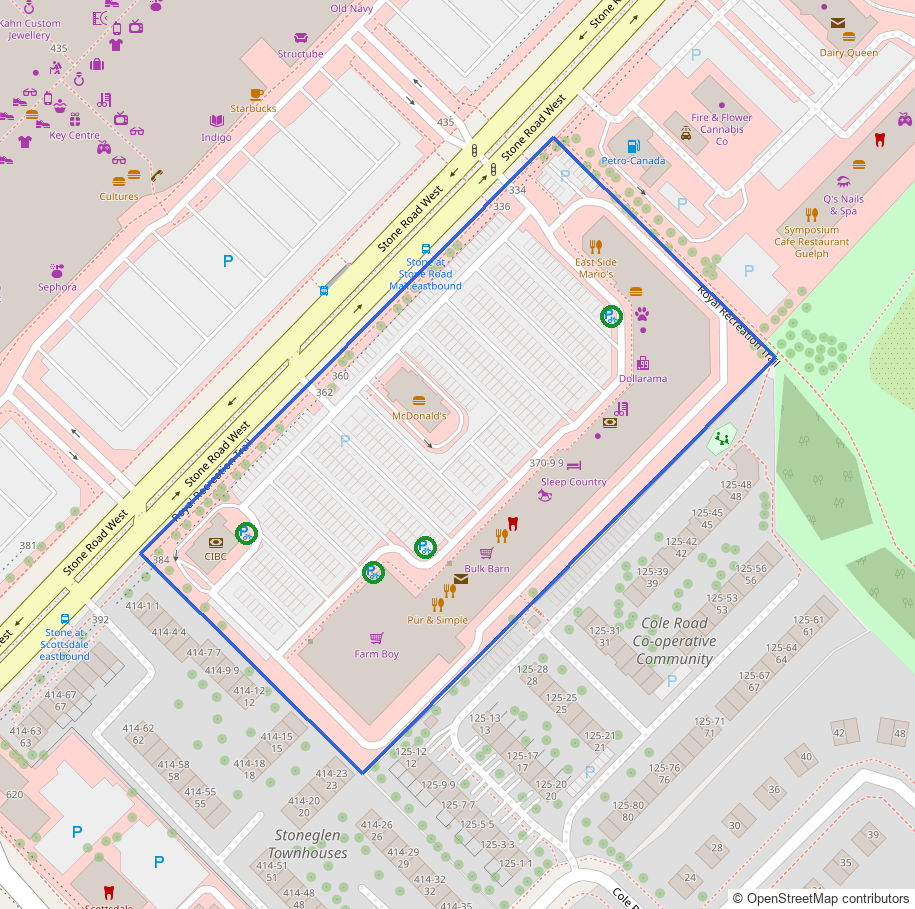

Bike parking found:

- [node 11225402345](https://www.openstreetmap.org/node/11225402345): stands, capacity 6
- [node 12206912381](https://www.openstreetmap.org/node/12206912381): stands, capacity 5
- [node 12206929334](https://www.openstreetmap.org/node/12206929334): stands, capacity 5
- [node 12206930210](https://www.openstreetmap.org/node/12206930210): stands, capacity 5

### Stonegate Plaza

**❌ none mapped**  ·  [OpenStreetMap](https://www.openstreetmap.org/way/212559744)  ·  [map view](https://www.openstreetmap.org/#map=18/43.51904/-80.23388)  ·  0.2 ha  ·  12 tenants mapped

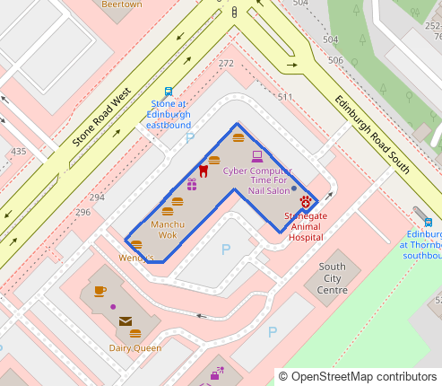

No bike parking mapped on the property. Nearest mapped rack is 128 m away ([node 13963396495](https://www.openstreetmap.org/node/13963396495)).

### Sugarbush Plaza

**❌ none mapped**  ·  [OpenStreetMap](https://www.openstreetmap.org/way/993366503)  ·  [map view](https://www.openstreetmap.org/#map=18/43.54077/-80.29145)  ·  0.5 ha  ·  4 tenants mapped

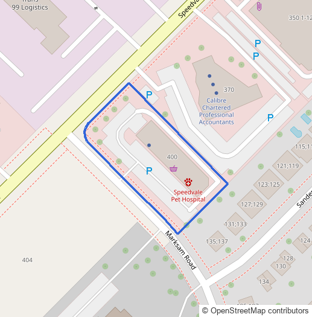

No bike parking mapped on the property. Nearest mapped rack is 356 m away ([node 12798111182](https://www.openstreetmap.org/node/12798111182)).

### University Square Plaza

**✅ has parking**  ·  [OpenStreetMap](https://www.openstreetmap.org/way/399321881)  ·  [map view](https://www.openstreetmap.org/#map=18/43.52124/-80.21261)  ·  1.1 ha  ·  13 tenants mapped

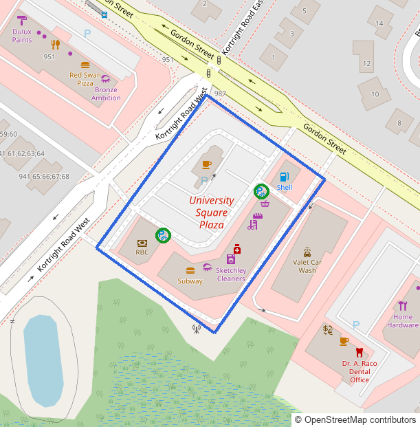

Bike parking found:

- [node 12823764356](https://www.openstreetmap.org/node/12823764356): stands, capacity 2
- [node 12823829004](https://www.openstreetmap.org/node/12823829004): stands, covered, capacity 2

### 10-20 Woodlawn Road East (unnamed)

**✅ has parking**  ·  [OpenStreetMap](https://www.openstreetmap.org/way/239062267)  ·  [map view](https://www.openstreetmap.org/#map=18/43.56687/-80.27672)  ·  4.4 ha  ·  8 tenants mapped

No name in OpenStreetMap. Tenants: Buck or Two, Canadian Tire, City Pizza, Spanky's BBQ, Stacked Pancake & Breakfast House, Staples, Taco Bell, amenity=shelter.

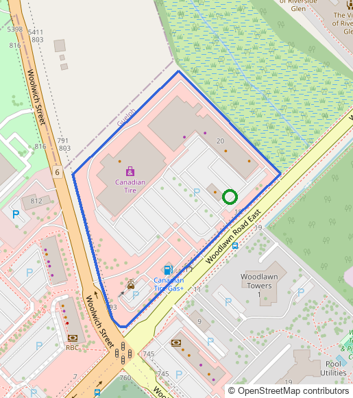

Bike parking found:

- [node 12757840252](https://www.openstreetmap.org/node/12757840252): stands, capacity 2

### 1027 Gordon Street (unnamed)

**🟡 nearby only**  ·  [OpenStreetMap](https://www.openstreetmap.org/way/773000852)  ·  [map view](https://www.openstreetmap.org/#map=18/43.52064/-80.21120)  ·  0.8 ha  ·  9 tenants mapped

No name in OpenStreetMap. Tenants: Beauty Queen Health Center, Centurion Coffee, Dr. A. Raco Dental Office, Home Hardware, Homelife Power Realty Inc Brokerage, Mary's Nails, Paola's Fine Cheeses, Rowe Farms….

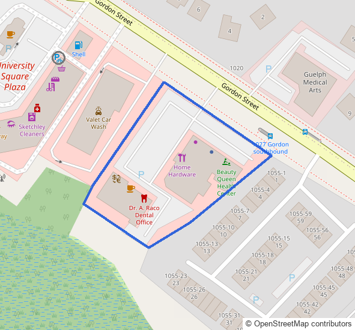

No bike parking mapped on the property. Nearest mapped rack is 73 m away ([node 12823764356](https://www.openstreetmap.org/node/12823764356)).

### 104 Silvercreek Parkway North (unnamed)

**✅ has parking**  ·  [OpenStreetMap](https://www.openstreetmap.org/way/295926707)  ·  [map view](https://www.openstreetmap.org/#map=18/43.53824/-80.27935)  ·  1.3 ha  ·  7 tenants mapped

No name in OpenStreetMap. Tenants: Canada Post, Money Direct, Pizzaville, RBC, Sherwin-Williams, Shoppers Drug Mart, Willow West Dental.

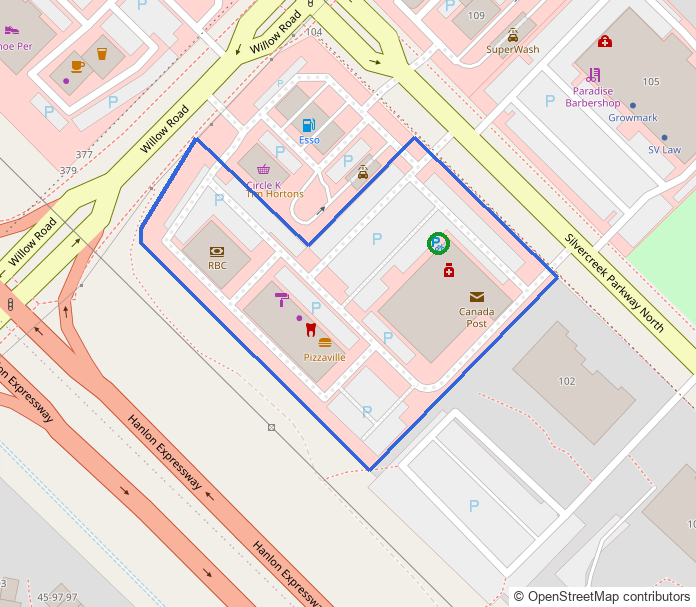

Bike parking found:

- [node 9789312722](https://www.openstreetmap.org/node/9789312722): stands, capacity 3

### 105 Silvercreek Parkway North (unnamed)

**🟡 nearby only**  ·  [OpenStreetMap](https://www.openstreetmap.org/way/295926658)  ·  [map view](https://www.openstreetmap.org/#map=18/43.53895/-80.27791)  ·  0.9 ha  ·  5 tenants mapped

No name in OpenStreetMap. Tenants: Growmark, Paradise Barbershop, Rexall, SV Law, Silvercreek Walk-In Clinic.

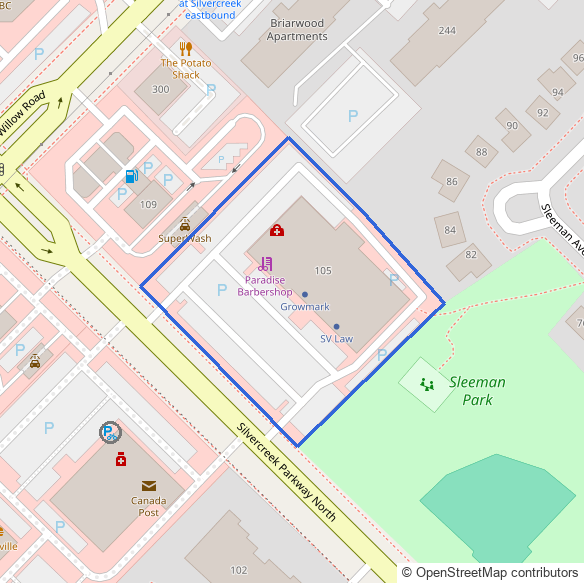

No bike parking mapped on the property. Nearest mapped rack is 54 m away ([node 9789312722](https://www.openstreetmap.org/node/9789312722)).

### 127-201 Stone Road West (unnamed)

**✅ has parking**  ·  [OpenStreetMap](https://www.openstreetmap.org/way/215068137)  ·  [map view](https://www.openstreetmap.org/#map=18/43.52308/-80.23196)  ·  7.9 ha  ·  6 tenants mapped

No name in OpenStreetMap. Tenants: Best Buy, Canadian Tire, Milestones, Montana's, Subway, Walmart Supercentre.

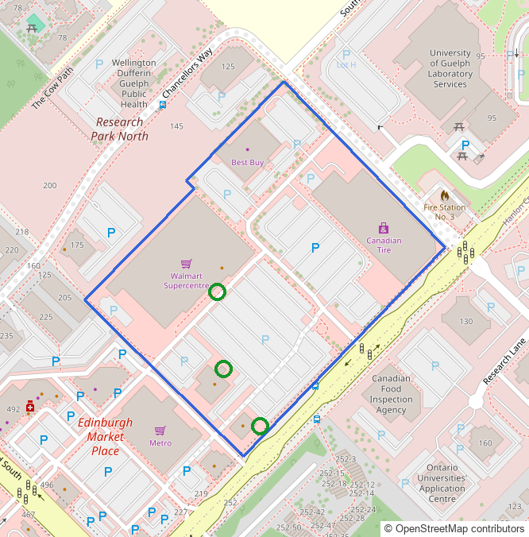

Bike parking found:

- [node 12030078101](https://www.openstreetmap.org/node/12030078101): stands, capacity 10
- [node 12335563263](https://www.openstreetmap.org/node/12335563263): stands, capacity 6
- [node 13963346866](https://www.openstreetmap.org/node/13963346866): stands, covered, capacity 8

### 1388-1398 Gordon Street (unnamed)

**❌ none mapped**  ·  [OpenStreetMap](https://www.openstreetmap.org/way/192887202)  ·  [map view](https://www.openstreetmap.org/#map=18/43.51281/-80.19753)  ·  0.5 ha  ·  8 tenants mapped

No name in OpenStreetMap. Tenants: Borealis Grille & Bar, Crock A Doodle, Dr. Nafeesa Sheikh Dentistry, Edward Jones, Liberty Tax, Purba Vision, Sweet Temptations Cupcakery, Vision Travel.

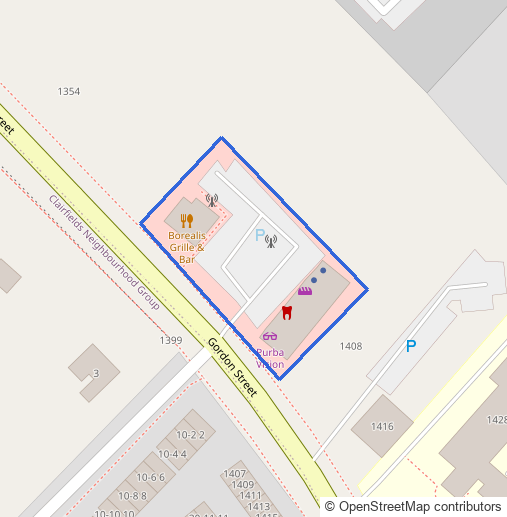

No bike parking mapped on the property. Nearest mapped rack is 179 m away ([node 12327064780](https://www.openstreetmap.org/node/12327064780)).

### 1499-1515 Gordon Street (unnamed)

**✅ has parking**  ·  [OpenStreetMap](https://www.openstreetmap.org/way/399342895)  ·  [map view](https://www.openstreetmap.org/#map=18/43.50936/-80.19642)  ·  1.3 ha  ·  14 tenants mapped

No name in OpenStreetMap. Tenants: Cavan Coffee, Domino's, Dr. Ye & Associates, Gordon Walk-In-Clinic, Guelph Family Health Team, HearingLife, J. Supply Co., Olive Tree….

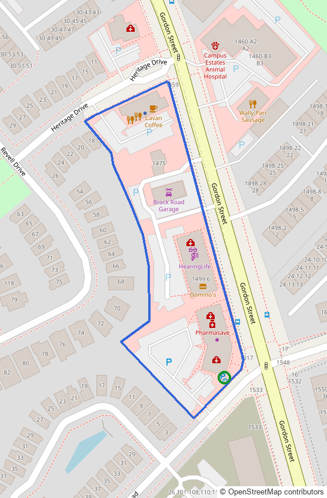

Bike parking found:

- [node 14106382405](https://www.openstreetmap.org/node/14106382405): stands, capacity 2

### 159 Fife Road (unnamed)

**❌ none mapped**  ·  [OpenStreetMap](https://www.openstreetmap.org/way/773030532)  ·  [map view](https://www.openstreetmap.org/#map=18/43.51400/-80.27597)  ·  0.3 ha  ·  4 tenants mapped

No name in OpenStreetMap. Tenants: Hale Veterinary Clinic, Hasty Market, Jumbo 3 for 1 Pizza & Wings, Layan Food Market.

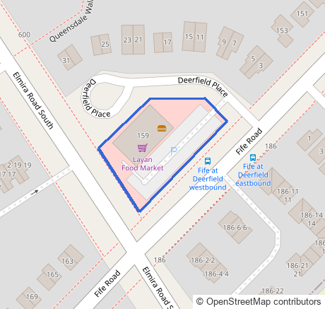

No bike parking mapped on the property. Nearest mapped rack is 1010 m away ([node 13233449397](https://www.openstreetmap.org/node/13233449397)).

### 170 Silvercreek Parkway North (unnamed)

**✅ has parking**  ·  [OpenStreetMap](https://www.openstreetmap.org/way/971832743)  ·  [map view](https://www.openstreetmap.org/#map=18/43.54054/-80.28244)  ·  1.0 ha  ·  8 tenants mapped

No name in OpenStreetMap. Tenants: Fresh Salon & Spa, Greengate Medical Centre Walk-In Clinic, Guardian, Mary Brown's, Parties Plus, Plato's Closet, Style Encore, The Indian Supermarket.

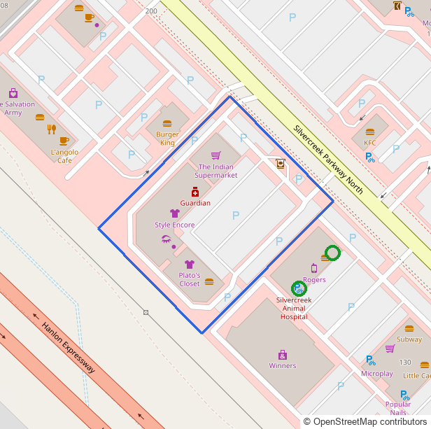

Bike parking found:

- [node 9789312727](https://www.openstreetmap.org/node/9789312727): type not tagged
- [node 9789312728](https://www.openstreetmap.org/node/9789312728): bollard

### 188-196 Waterloo Avenue (unnamed)

**❌ none mapped**  ·  [OpenStreetMap](https://www.openstreetmap.org/way/772999948)  ·  [map view](https://www.openstreetmap.org/#map=18/43.53592/-80.25512)  ·  0.3 ha  ·  4 tenants mapped

No name in OpenStreetMap. Tenants: Buzz Hair Salon, Goldcap Realty, Retro Convenience, Van Allen Insurance.

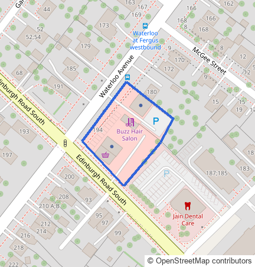

No bike parking mapped on the property. Nearest mapped rack is 310 m away ([node 12058128705](https://www.openstreetmap.org/node/12058128705)).

### 200-206 Silvercreek Parkway North (unnamed)

**🟡 nearby only**  ·  [OpenStreetMap](https://www.openstreetmap.org/way/295926125)  ·  [map view](https://www.openstreetmap.org/#map=18/43.54122/-80.28338)  ·  1.4 ha  ·  8 tenants mapped

No name in OpenStreetMap. Tenants: Burger King, Cashco Loans, Domino's, Kung Fu Tea, L’angolo Cafe, Pita Pit, Royal Paan, The Salvation Army.

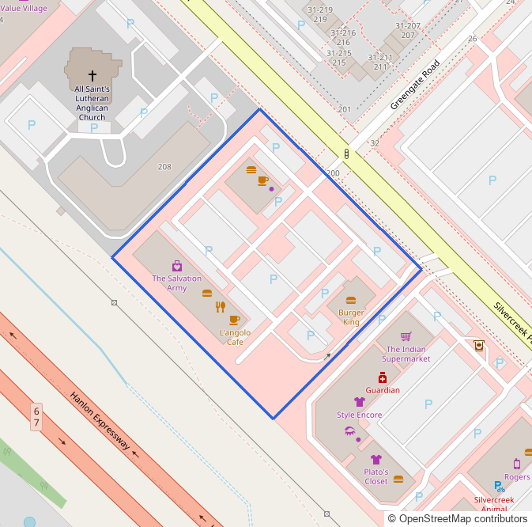

No bike parking mapped on the property. Nearest mapped rack is 95 m away ([node 12164866906](https://www.openstreetmap.org/node/12164866906)).

### 200-234 Victoria Road South (unnamed)

**✅ has parking**  ·  [OpenStreetMap](https://www.openstreetmap.org/way/539479797)  ·  [map view](https://www.openstreetmap.org/#map=18/43.55191/-80.22172)  ·  3.7 ha  ·  13 tenants mapped

No name in OpenStreetMap. Tenants: Eggcetra, Ethnic Supermarket, FillStore Convenience, Guelph Eye Care, Mission Thrift Store, Nature's Salt Cave, Sunglass Cove, The Octave Music Centre….

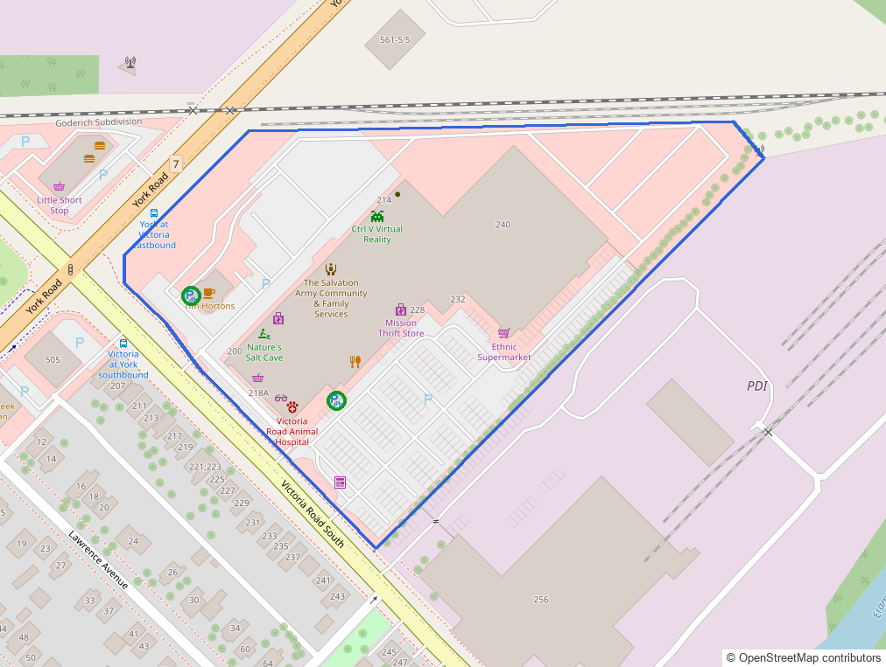

Bike parking found:

- [node 11461813869](https://www.openstreetmap.org/node/11461813869): type not tagged
- [node 12270389287](https://www.openstreetmap.org/node/12270389287): informal

### 204 Yorkshire Street North (unnamed)

**❌ none mapped**  ·  [OpenStreetMap](https://www.openstreetmap.org/way/772951791)  ·  [map view](https://www.openstreetmap.org/#map=18/43.54459/-80.26101)  ·  0.7 ha  ·  4 tenants mapped

No name in OpenStreetMap. Tenants: Barber Glass, Quick Stop Variety, Two Plus Pizza, Valeriote Market & Butchery.

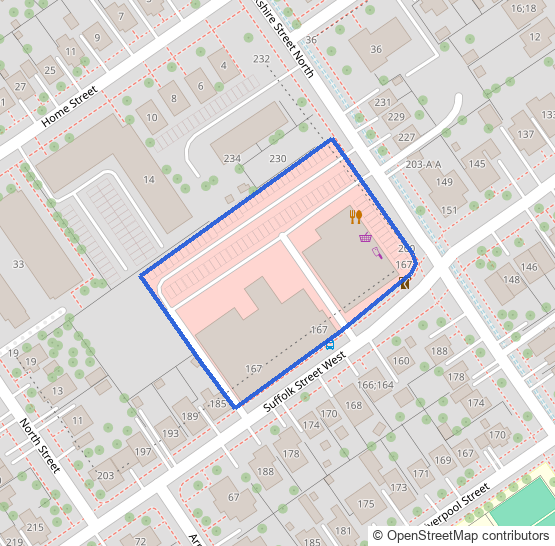

No bike parking mapped on the property. Nearest mapped rack is 142 m away ([node 12810727443](https://www.openstreetmap.org/node/12810727443)).

### 208-222 Silvercreek Parkway North (unnamed)

**✅ has parking**  ·  [OpenStreetMap](https://www.openstreetmap.org/way/295926200)  ·  [map view](https://www.openstreetmap.org/#map=18/43.54308/-80.28594)  ·  2.8 ha  ·  15 tenants mapped

No name in OpenStreetMap. Tenants: 24 De Nails Ltd., Dollarama, Downtown Dentistry, Drizzora Desserts, Fairstone Financial, Food Basics, Play It Again Sports, Renaissance Jewellery & Watch Repair….

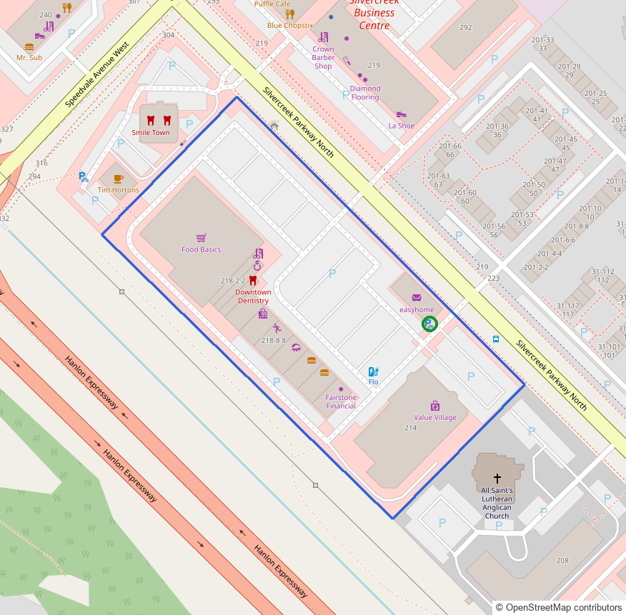

Bike parking found:

- [node 12164899589](https://www.openstreetmap.org/node/12164899589): stands, capacity 5

### 21-35 Woodlawn Road West (unnamed)

**✅ has parking**  ·  [OpenStreetMap](https://www.openstreetmap.org/way/772928910)  ·  [map view](https://www.openstreetmap.org/#map=18/43.56385/-80.28015)  ·  1.7 ha  ·  5 tenants mapped

No name in OpenStreetMap. Tenants: Boston Pizza, Julia's Nail Salon, Uptown Guelph Dental, Wayfare Motel Office, Younique Scrapbook Store.

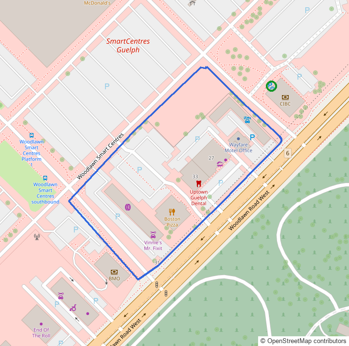

Bike parking found:

- [node 12713893391](https://www.openstreetmap.org/node/12713893391): stands

### 221-223 Woodlawn Road West (unnamed)

**🟡 nearby only**  ·  [OpenStreetMap](https://www.openstreetmap.org/way/773015473)  ·  [map view](https://www.openstreetmap.org/#map=18/43.55473/-80.29279)  ·  1.6 ha  ·  16 tenants mapped

No name in OpenStreetMap. Tenants: 3 for 1 Glasses, 9Round, Body Klense, Burrito Boys, Caribbean Delight, Cash Money, Coffee Stiles, Crown Bath & Kitchen….

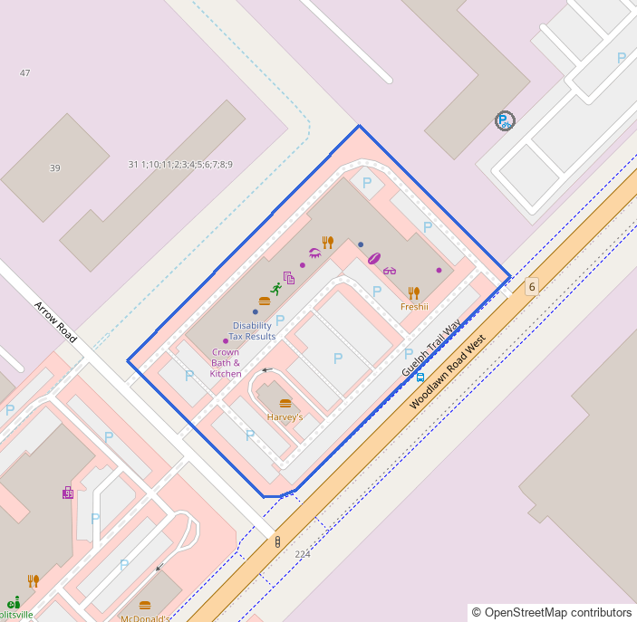

No bike parking mapped on the property. Nearest mapped rack is 51 m away ([node 13233491582](https://www.openstreetmap.org/node/13233491582)).

### 241-249 Edinburgh Road North (unnamed)

**❌ none mapped**  ·  [OpenStreetMap](https://www.openstreetmap.org/way/772950211)  ·  [map view](https://www.openstreetmap.org/#map=18/43.54439/-80.26695)  ·  1.1 ha  ·  4 tenants mapped

No name in OpenStreetMap. Tenants: G&A Locks & Security, Mobility in Motion, Rainbow Variety, Royal City Restaurant.

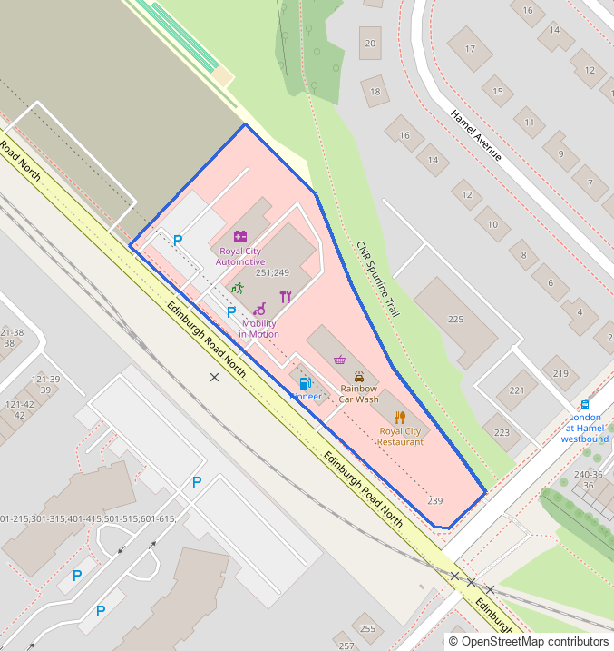

No bike parking mapped on the property. Nearest mapped rack is 255 m away ([node 12300313453](https://www.openstreetmap.org/node/12300313453)).

### 252 Silvercreek Parkway North (unnamed)

**🟡 nearby only**  ·  [OpenStreetMap](https://www.openstreetmap.org/way/773015485)  ·  [map view](https://www.openstreetmap.org/#map=18/43.54496/-80.28854)  ·  2.0 ha  ·  9 tenants mapped

No name in OpenStreetMap. Tenants: Buns Master, Culligan, Hakim Optical, Mr. Sub, Old Fashioned Deli, Pho Saigon, Thanh Phat, Winnie Duyen Hair Salan & Spa….

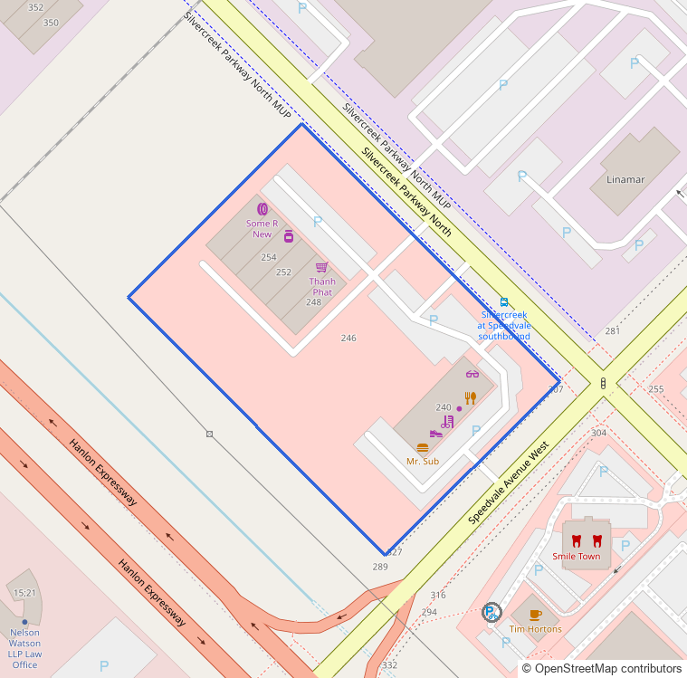

No bike parking mapped on the property. Nearest mapped rack is 55 m away ([node 12312591588](https://www.openstreetmap.org/node/12312591588)).

### 265-297 Eramosa Road (unnamed)

**✅ has parking**  ·  [OpenStreetMap](https://www.openstreetmap.org/way/772911628)  ·  [map view](https://www.openstreetmap.org/#map=18/43.55838/-80.24799)  ·  5.1 ha  ·  6 tenants mapped

No name in OpenStreetMap. Tenants: First Choice Haircutters, GoodLife Fitness, Kirtida Kitchen, Rexall, The Co-operators, Zehrs.

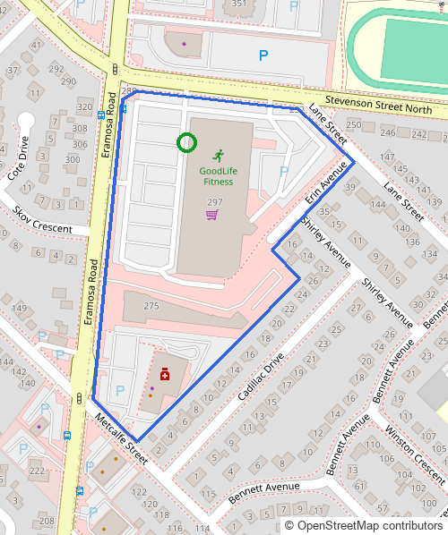

Bike parking found:

- [node 13062606915](https://www.openstreetmap.org/node/13062606915): stands

### 292-314 Stone Road West (unnamed)

**🟡 nearby only**  ·  [OpenStreetMap](https://www.openstreetmap.org/way/369321286)  ·  [map view](https://www.openstreetmap.org/#map=18/43.51847/-80.23435)  ·  3.2 ha  ·  26 tenants mapped

No name in OpenStreetMap. Tenants: Apps Optical, Body Systems Nutrition, Brodie's Gaming & Collectables, Cyber Computer, Dairy Queen, Domino's, Dough Box, Edible Arrangements….

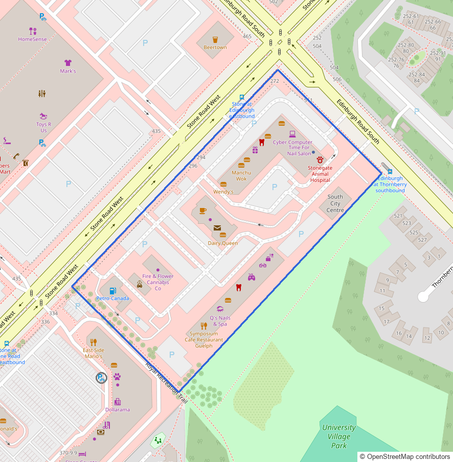

No bike parking mapped on the property. Nearest mapped rack is 38 m away ([node 12206930210](https://www.openstreetmap.org/node/12206930210)).

### 320 Eastview Road (unnamed)

**❌ none mapped**  ·  [OpenStreetMap](https://www.openstreetmap.org/way/358488660)  ·  [map view](https://www.openstreetmap.org/#map=18/43.57895/-80.22427)  ·  1.4 ha  ·  8 tenants mapped

No name in OpenStreetMap. Tenants: East Guelph Medical Clinic, Eastview Physiotherapy, Gino's Pizza, Guelph Lake Veterinary Hospital, Guelph Peoples Pharmacy, Hasty Market, North Eastview Family Dental, Wild Wing.

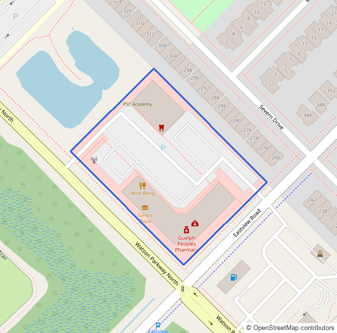

No bike parking mapped on the property. Nearest mapped rack is 1589 m away ([node 12099376342](https://www.openstreetmap.org/node/12099376342)).

### 340 Woodlawn Road West (unnamed)

**❌ none mapped**  ·  [OpenStreetMap](https://www.openstreetmap.org/way/399149070)  ·  [map view](https://www.openstreetmap.org/#map=18/43.54808/-80.29846)  ·  3.5 ha  ·  13 tenants mapped

No name in OpenStreetMap. Tenants: All-Risks Insurance Brokers Limited, Asian Food Centre, Buckenham Fireplaces & Grills, Canadian Grill, City View Pools And Patio Furniture, Goodwill Community Store, Goodwill Donation Centre, Kingsway Fishing Tackle….

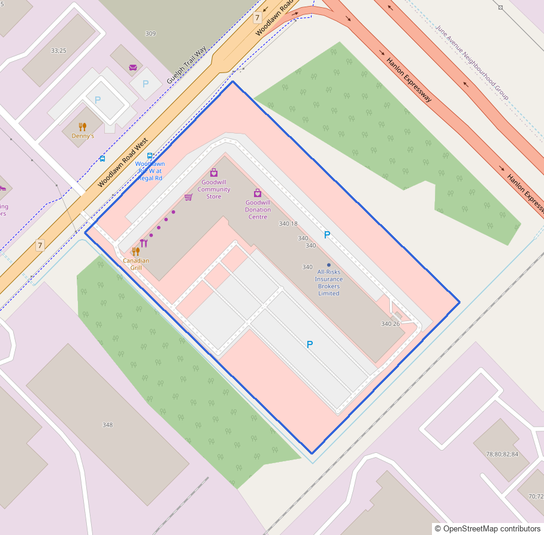

No bike parking mapped on the property. Nearest mapped rack is 864 m away ([node 12312591588](https://www.openstreetmap.org/node/12312591588)).

### 380 Eramosa Road (unnamed)

**❌ none mapped**  ·  [OpenStreetMap](https://www.openstreetmap.org/way/772911624)  ·  [map view](https://www.openstreetmap.org/#map=18/43.56163/-80.24954)  ·  3.0 ha  ·  9 tenants mapped

No name in OpenStreetMap. Tenants: Dairy Queen, Dollarama, Food Basics, Guelph Public Library - Bullfrog Mall Branch, KazaMeza, Mary Brown's, Pizza Pizza, TD….

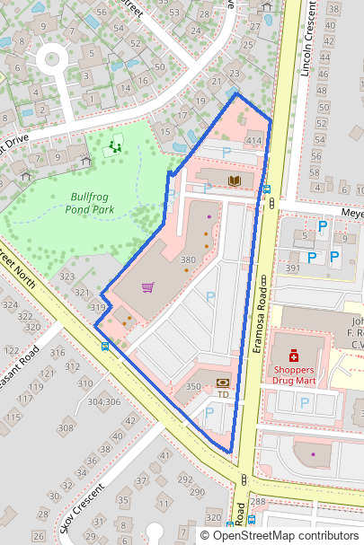

No bike parking mapped on the property. Nearest mapped rack is 128 m away ([node 13062606915](https://www.openstreetmap.org/node/13062606915)).

### 4-124 Clair Road East (unnamed)

**✅ has parking**  ·  [OpenStreetMap](https://www.openstreetmap.org/way/399319859)  ·  [map view](https://www.openstreetmap.org/#map=18/43.50205/-80.18947)  ·  5.5 ha  ·  24 tenants mapped

No name in OpenStreetMap. Tenants: BarBurrito, BodySystems Nutrition, CIBC, Chuck's Roadhouse, Firehouse Subs, First Choice Haircutters, Freshii, LCBO….

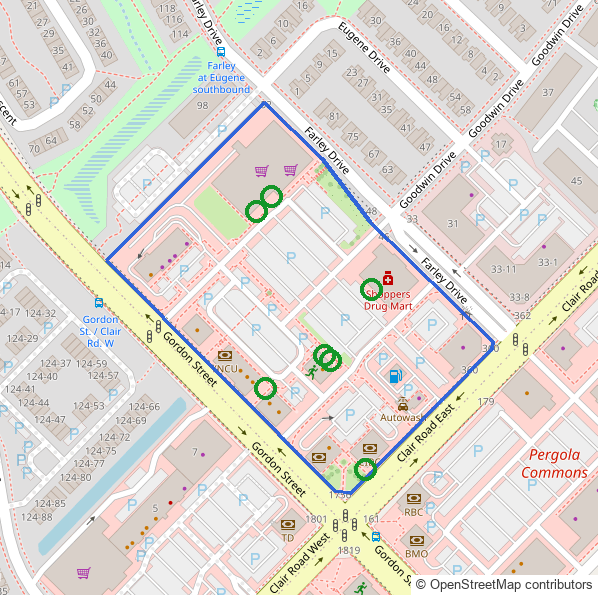

Bike parking found:

- [node 12823720968](https://www.openstreetmap.org/node/12823720968): type not tagged
- [node 12823720970](https://www.openstreetmap.org/node/12823720970): type not tagged
- [node 12823720971](https://www.openstreetmap.org/node/12823720971): stands
- [node 12823787991](https://www.openstreetmap.org/node/12823787991): type not tagged
- [node 12823796244](https://www.openstreetmap.org/node/12823796244): type not tagged
- [node 12823816372](https://www.openstreetmap.org/node/12823816372): type not tagged
- [node 12823816373](https://www.openstreetmap.org/node/12823816373): type not tagged

### 415-429 Woodlawn Road West (unnamed)

**❌ none mapped**  ·  [OpenStreetMap](https://www.openstreetmap.org/way/399149099)  ·  [map view](https://www.openstreetmap.org/#map=18/43.54513/-80.30656)  ·  2.0 ha  ·  4 tenants mapped

No name in OpenStreetMap. Tenants: Tim Hortons, Wendy's, World of Hot Tubs, shop=convenience.

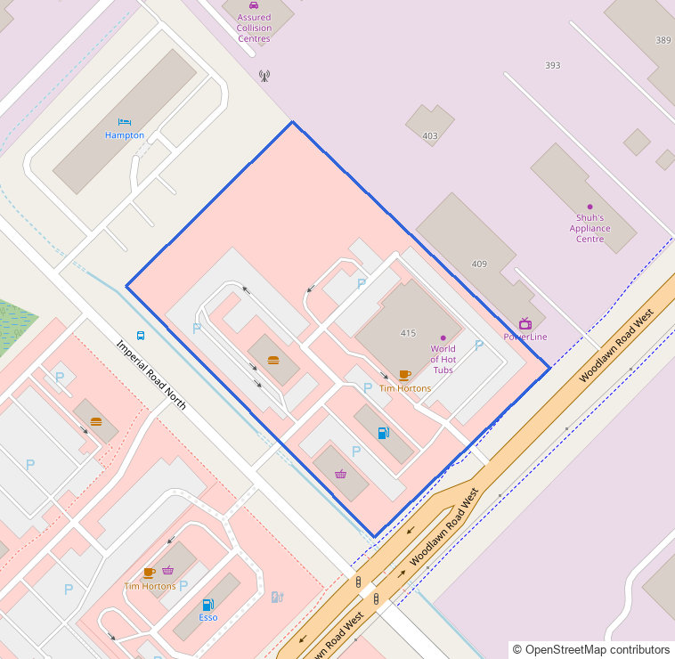

No bike parking mapped on the property. Nearest mapped rack is 1119 m away ([node 12798111182](https://www.openstreetmap.org/node/12798111182)).

### 450 Woodlawn Road West (unnamed)

**❌ none mapped**  ·  [OpenStreetMap](https://www.openstreetmap.org/way/773016985)  ·  [map view](https://www.openstreetmap.org/#map=18/43.54315/-80.30661)  ·  1.0 ha  ·  4 tenants mapped

No name in OpenStreetMap. Tenants: Bigelow Flooring, Coconut Coast, Neutron Electronics, Starberry Cafe.

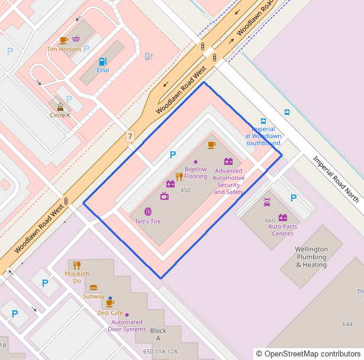

No bike parking mapped on the property. Nearest mapped rack is 1039 m away ([node 12798111182](https://www.openstreetmap.org/node/12798111182)).

### 465-565 Woodlawn Road West (unnamed)

**❌ none mapped**  ·  [OpenStreetMap](https://www.openstreetmap.org/way/962456073)  ·  [map view](https://www.openstreetmap.org/#map=18/43.54353/-80.30904)  ·  5.2 ha  ·  6 tenants mapped

No name in OpenStreetMap. Tenants: A&W, Galaxy Cinemas Guelph, Mandarin, Piper Arms, Sarmazian, Taco Bell.

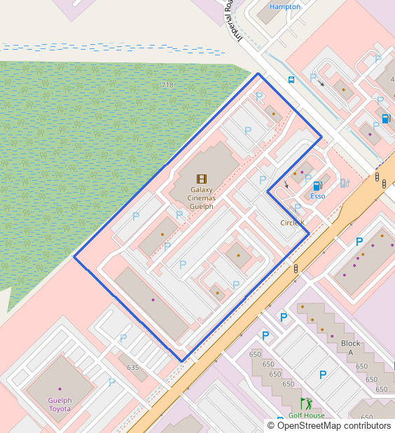

No bike parking mapped on the property. Nearest mapped rack is 1166 m away ([node 12798111182](https://www.openstreetmap.org/node/12798111182)).

### 486 Woodlawn Road East (unnamed)

**❌ none mapped**  ·  [OpenStreetMap](https://www.openstreetmap.org/way/772926644)  ·  [map view](https://www.openstreetmap.org/#map=18/43.57765/-80.26100)  ·  1.0 ha  ·  5 tenants mapped

No name in OpenStreetMap. Tenants: Helmand Kebab House, Kings Sports Bar and Grill, Laundromat, Tim Hortons, shop=convenience.

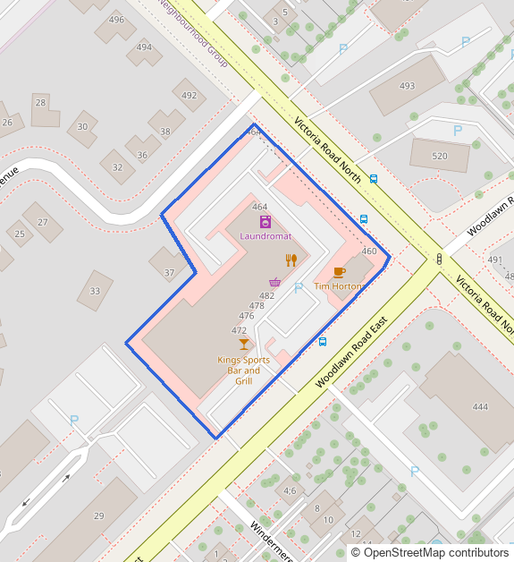

No bike parking mapped on the property. Nearest mapped rack is 1623 m away ([node 12757840252](https://www.openstreetmap.org/node/12757840252)).

### 50 Wellington Street East (unnamed)

**🟡 nearby only**  ·  [OpenStreetMap](https://www.openstreetmap.org/way/772999958)  ·  [map view](https://www.openstreetmap.org/#map=18/43.54178/-80.24475)  ·  1.2 ha  ·  4 tenants mapped

No name in OpenStreetMap. Tenants: A&W, KFC, Tim Hortons, Wendy's.

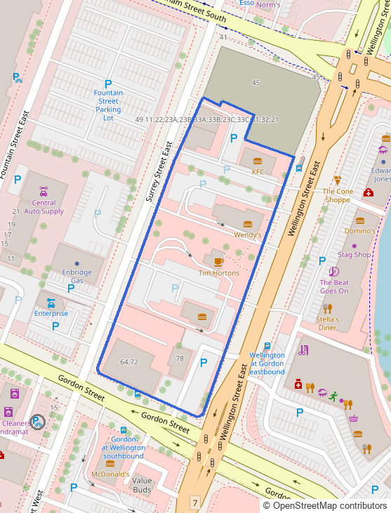

No bike parking mapped on the property. Nearest mapped rack is 49 m away ([node 13286323760](https://www.openstreetmap.org/node/13286323760)).

### 51-55 Woodlawn Road West (unnamed)

**✅ has parking**  ·  [OpenStreetMap](https://www.openstreetmap.org/way/772928908)  ·  [map view](https://www.openstreetmap.org/#map=18/43.56268/-80.28176)  ·  1.2 ha  ·  4 tenants mapped

No name in OpenStreetMap. Tenants: Coffee Time, End Of The Roll, Mobility in Motion, The Cannabist Shop.

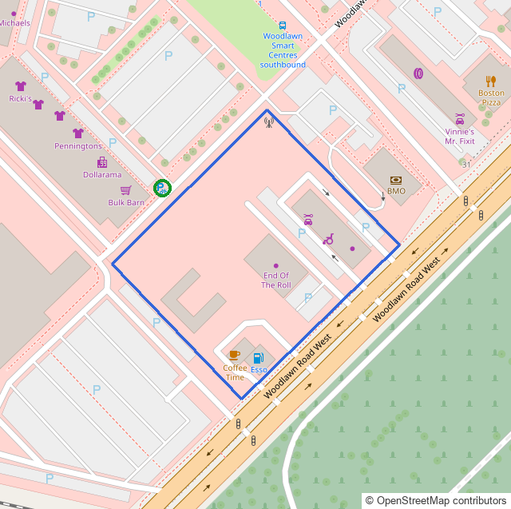

Bike parking found:

- [node 13027046604](https://www.openstreetmap.org/node/13027046604): stands, capacity 2

### 617-649 Scottsdale Drive (unnamed)

**❌ none mapped**  ·  [OpenStreetMap](https://www.openstreetmap.org/way/468349503)  ·  [map view](https://www.openstreetmap.org/#map=18/43.51427/-80.23896)  ·  2.4 ha  ·  4 tenants mapped

No name in OpenStreetMap. Tenants: LCBO, Pizza Hut, Reserved Cannabis, Shoppers Drug Mart.

No bike parking mapped on the property. Nearest mapped rack is 193 m away ([node 12206912381](https://www.openstreetmap.org/node/12206912381)).

### 630-650 Scottsdale Drive (unnamed)

**❌ none mapped**  ·  [OpenStreetMap](https://www.openstreetmap.org/way/468349505)  ·  [map view](https://www.openstreetmap.org/#map=18/43.51502/-80.23805)  ·  1.1 ha  ·  8 tenants mapped

No name in OpenStreetMap. Tenants: Fluffy Glaze, Gotcha Bubble Tea, Guelph BBQ, Guelph Public Library - Scottsdale Branch, Guelph Vapour Company, Hanna's Nail Bar, Paghman Kabob, Scottsdale Dental Centre.

No bike parking mapped on the property. Nearest mapped rack is 115 m away ([node 12206912381](https://www.openstreetmap.org/node/12206912381)).

### 666 Woolwich Street (unnamed)

**❌ none mapped**  ·  [OpenStreetMap](https://www.openstreetmap.org/way/772928901)  ·  [map view](https://www.openstreetmap.org/#map=18/43.55855/-80.26959)  ·  1.3 ha  ·  11 tenants mapped

No name in OpenStreetMap. Tenants: Canvision Optical Ltd, Double Double Pizza & Wings, Dutch Toko European Deli, First Choice Hair, Four Seasons Flowers, Little Short Stop, Once Upon A Child, Rexall….

No bike parking mapped on the property. Nearest mapped rack is 175 m away ([node 11450121869](https://www.openstreetmap.org/node/11450121869)).

### 670-698 Woolwich Street (unnamed)

**✅ has parking**  ·  [OpenStreetMap](https://www.openstreetmap.org/way/772928904)  ·  [map view](https://www.openstreetmap.org/#map=18/43.56037/-80.27226)  ·  3.6 ha  ·  10 tenants mapped

No name in OpenStreetMap. Tenants: Church's Chicken, Dominion Lending Centres, Edward Jones, Family Midwifery Care of Guelph, HearingLife, Pizza Express Guelph, Royal City Foot Clinic, Tim Hortons….

Bike parking found:

- [node 11450121869](https://www.openstreetmap.org/node/11450121869): stands, capacity 4
- [node 12223080895](https://www.openstreetmap.org/node/12223080895): stands
- [node 12223102222](https://www.openstreetmap.org/node/12223102222): stands
- [node 12223102223](https://www.openstreetmap.org/node/12223102223): stands

### 715 Wellington Street West (unnamed)

**✅ has parking**  ·  [OpenStreetMap](https://www.openstreetmap.org/way/364715613)  ·  [map view](https://www.openstreetmap.org/#map=18/43.52147/-80.26872)  ·  1.0 ha  ·  10 tenants mapped

No name in OpenStreetMap. Tenants: Global Pet Foods, Imperial Pharmacy, MM Physio, National Pasta, On the Run, Party Nails, Sam's Grill, Tim Hortons….

Bike parking found:

- [node 13233449397](https://www.openstreetmap.org/node/13233449397): stands

### 727-777 Woolwich Street (unnamed)

**🟡 nearby only**  ·  [OpenStreetMap](https://www.openstreetmap.org/way/772928906)  ·  [map view](https://www.openstreetmap.org/#map=18/43.56381/-80.27486)  ·  2.7 ha  ·  15 tenants mapped

No name in OpenStreetMap. Tenants: Big Smart Convenience, DUCA, Dairy Queen, Family & Implant Dentistry, Farnworth Memorials, Golden Fish & Chips, Guelph North Health Clinic, Love Shop….

No bike parking mapped on the property. Nearest mapped rack is 35 m away ([node 14088696229](https://www.openstreetmap.org/node/14088696229)).

### 75 Willow Road (unnamed)

**❌ none mapped**  ·  [OpenStreetMap](https://www.openstreetmap.org/way/773014769)  ·  [map view](https://www.openstreetmap.org/#map=18/43.54458/-80.27372)  ·  1.1 ha  ·  10 tenants mapped

No name in OpenStreetMap. Tenants: H&R Block, Healing Centre, Little Short Stop, Mickey Nails, Pizza Pizza, Super Coin Laundry, Warka Tree, Willow Medical Clinic….

No bike parking mapped on the property. Nearest mapped rack is 128 m away ([node 9789312730](https://www.openstreetmap.org/node/9789312730)).

### 86-100 Gordon Street (unnamed)

**✅ has parking**  ·  [OpenStreetMap](https://www.openstreetmap.org/way/772999957)  ·  [map view](https://www.openstreetmap.org/#map=18/43.54118/-80.24350)  ·  1.7 ha  ·  26 tenants mapped

No name in OpenStreetMap. Tenants: Bare Essentials, Domino's, Edward Jones, Ewyn Weight Loss Studios, F45 Training, Franco and Sons Barber Shop, Fusion Authentic Indian Cuisine, Guelph Animal Hospital….

Bike parking found:

- [node 12170563930](https://www.openstreetmap.org/node/12170563930): bollard, covered, capacity 8

### 89-105 Gordon Street (unnamed)

**✅ has parking**  ·  [OpenStreetMap](https://www.openstreetmap.org/way/328207036)  ·  [map view](https://www.openstreetmap.org/#map=18/43.53970/-80.24441)  ·  1.4 ha  ·  7 tenants mapped

No name in OpenStreetMap. Tenants: Bardo, Freshii, Goodness Me!, LCBO, Starbucks, The Running Works, Z-Teca.

Bike parking found:

- [node 12015891543](https://www.openstreetmap.org/node/12015891543): stands, capacity 4
- [node 13233343763](https://www.openstreetmap.org/node/13233343763): stands

### 926 Paisley Road (unnamed)

**🟡 nearby only**  ·  [OpenStreetMap](https://www.openstreetmap.org/way/256252178)  ·  [map view](https://www.openstreetmap.org/#map=18/43.52576/-80.28505)  ·  0.5 ha  ·  5 tenants mapped

No name in OpenStreetMap. Tenants: Circle K, M&M Food Market, Tranquil Hair & Body, VP Tailors, West End Family Chiropractic.

No bike parking mapped on the property. Nearest mapped rack is 38 m away ([node 9768470934](https://www.openstreetmap.org/node/9768470934)).

### 951 Gordon Street (unnamed)

**🟡 nearby only**  ·  [OpenStreetMap](https://www.openstreetmap.org/way/399321888)  ·  [map view](https://www.openstreetmap.org/#map=18/43.52210/-80.21375)  ·  0.8 ha  ·  10 tenants mapped

No name in OpenStreetMap. Tenants: Alpenglow Leaf, Bronze Ambition, Dulux Paints, Farm To Paw, Manhattans, Nighthawk Tattoo, Palmer Cleaning Centres, Red Swan Pizza….

No bike parking mapped on the property. Nearest mapped rack is 64 m away ([node 12823829004](https://www.openstreetmap.org/node/12823829004)).

### Wellington Plaza

**✅ has parking**  ·  [OpenStreetMap](https://www.openstreetmap.org/way/177697922)  ·  [map view](https://www.openstreetmap.org/#map=18/43.54106/-80.24365)  ·  0.2 ha  ·  10 tenants mapped

Bike parking found:

- [node 12170563930](https://www.openstreetmap.org/node/12170563930): bollard, covered, capacity 8

### West Hills Plaza

**✅ has parking**  ·  [OpenStreetMap](https://www.openstreetmap.org/way/256252221)  ·  [map view](https://www.openstreetmap.org/#map=18/43.52351/-80.28844)  ·  7.1 ha  ·  19 tenants mapped

Bike parking found:

- [node 9768470930](https://www.openstreetmap.org/node/9768470930): bollard
- [node 9768470931](https://www.openstreetmap.org/node/9768470931): bollard
- [node 9768470932](https://www.openstreetmap.org/node/9768470932): rack
- [node 9768470933](https://www.openstreetmap.org/node/9768470933): stands

### Westwood Plaza

**✅ has parking**  ·  [OpenStreetMap](https://www.openstreetmap.org/way/1192488955)  ·  [map view](https://www.openstreetmap.org/#map=18/43.53296/-80.28767)  ·  0.6 ha  ·  10 tenants mapped

Bike parking found:

- [node 9768470920](https://www.openstreetmap.org/node/9768470920): type not tagged

### Willow West

**✅ has parking**  ·  [OpenStreetMap](https://www.openstreetmap.org/way/208496000)  ·  [map view](https://www.openstreetmap.org/#map=18/43.54147/-80.28012)  ·  1.8 ha  ·  13 tenants mapped

Bike parking found:

- [node 9789312729](https://www.openstreetmap.org/node/9789312729): type not tagged

### Woodlawn Square

**❌ none mapped**  ·  [OpenStreetMap](https://www.openstreetmap.org/way/773015474)  ·  [map view](https://www.openstreetmap.org/#map=18/43.55307/-80.29531)  ·  4.5 ha  ·  8 tenants mapped

No bike parking mapped on the property. Nearest mapped rack is 230 m away ([node 13233491582](https://www.openstreetmap.org/node/13233491582)).

## Enclosed malls (not strip plazas, listed for completeness)

### Stone Road Mall

**✅ has parking**  ·  [OpenStreetMap](https://www.openstreetmap.org/way/121261616)  ·  2 racks, capacity 10

- [node 11480123369](https://www.openstreetmap.org/node/11480123369): stands, capacity 6
- [node 12095999648](https://www.openstreetmap.org/node/12095999648): stands, capacity 4

### Old Quebec Street

**✅ has parking**  ·  [OpenStreetMap](https://www.openstreetmap.org/way/123274454)  ·  1 racks, capacity 4

- [node 11194039137](https://www.openstreetmap.org/node/11194039137): rack, capacity 4

## Possible plazas not drawn as areas in OpenStreetMap

Clusters of four or more businesses within 60 m of each other that fall outside every retail area in the map. Some are strip plazas nobody has outlined yet; some are storefront rows on a main street. Not screenshotted or scored.

| Location | Businesses |
|---|---|
| [43.54993, -80.22700](https://www.openstreetmap.org/#map=18/43.54993/-80.22700) | Base & Co Hair Studio, Lost Aviator Coffee Co., Sam's Auto Service, York Auto Sales |
| [43.54209, -80.28976](https://www.openstreetmap.org/#map=18/43.54209/-80.28976) | Champion's Choice, Diwa Classic Indian Cuisine, Holistic Health Spa, India Spice House, Moose Lake Dental, Passages |
| [43.53064, -80.22628](https://www.openstreetmap.org/#map=18/43.53064/-80.22628) | Booster Juice, Campus Dentist, Campus Optical, Chat Time, ClickSIGNS, KFC… |
| [43.55228, -80.22541](https://www.openstreetmap.org/#map=18/43.55228/-80.22541) | 3 Well by Syd, KJ Urban Winery & Craft Brewing Supplies, Royal City Brewing - Beer Hall & Ward Room, The Sacremyst Academy |
| [43.54240, -80.30734](https://www.openstreetmap.org/#map=18/43.54240/-80.30734) | Automated Door Systems, Pho Kinh Do, Subway, Zest Cafe |
| [43.55004, -80.27675](https://www.openstreetmap.org/#map=18/43.55004/-80.27675) | Dawson Road Family Medical Clinic, DiabetesCare Guelph, Guelph Medical Place Pharmacy, Sense of Hearing |
| [43.53238, -80.30468](https://www.openstreetmap.org/#map=18/43.53238/-80.30468) | All About Grooming, Kal Tire, Krella Gas Fireplaces, Line-X Protective Coatings, Make It Sew Embroidery |
| [43.51664, -80.20390](https://www.openstreetmap.org/#map=18/43.51664/-80.20390) | CoCo Fresh Tea & Juice, Gordon Sushi House, Savage Cloud Vape Shop, Simply Convenient |
| [43.55852, -80.26760](https://www.openstreetmap.org/#map=18/43.55852/-80.26760) | Dulux Paints, Dynamite Pizza, Guelph Pain Clinic, I.D.A., Lynn's Nails |
| [43.54785, -80.28220](https://www.openstreetmap.org/#map=18/43.54785/-80.28220) | Guelph Studio Massage Spa, Hair Styling Den, Jiffy Lube, Oapex Ltd. |
| [43.55829, -80.28581](https://www.openstreetmap.org/#map=18/43.55829/-80.28581) | Kelsey's, Swiss Chalet, Tim Hortons, Valet Car Wash |

## Retail areas checked and not treated as plazas

Unnamed `landuse=retail` areas with fewer than four named businesses mapped: gas stations, car dealers, single stores, or simply under-mapped lots.

| OSM way | Size | Businesses mapped |
|---|---|---|
| [548776291](https://www.openstreetmap.org/way/548776291) | 5.89 ha | Costco, Costco Food Court, Costco Pharmacy |
| [773036284](https://www.openstreetmap.org/way/773036284) | 4.57 ha | — |
| [328198358](https://www.openstreetmap.org/way/328198358) | 3.31 ha | — |
| [239063741](https://www.openstreetmap.org/way/239063741) | 3.15 ha | The Home Depot |
| [399149170](https://www.openstreetmap.org/way/399149170) | 2.21 ha | — |
| [773016984](https://www.openstreetmap.org/way/773016984) | 2.18 ha | — |
| [388354347](https://www.openstreetmap.org/way/388354347) | 2.07 ha | — |
| [399149097](https://www.openstreetmap.org/way/399149097) | 1.87 ha | — |
| [772928898](https://www.openstreetmap.org/way/772928898) | 1.64 ha | Kelsey's, Swiss Chalet, Tim Hortons |
| [773036286](https://www.openstreetmap.org/way/773036286) | 1.61 ha | — |
| [399149398](https://www.openstreetmap.org/way/399149398) | 1.47 ha | — |
| [399149441](https://www.openstreetmap.org/way/399149441) | 1.38 ha | — |
| [398946241](https://www.openstreetmap.org/way/398946241) | 1.37 ha | Home Hardware |
| [1005072625](https://www.openstreetmap.org/way/1005072625) | 1.27 ha | — |
| [773016982](https://www.openstreetmap.org/way/773016982) | 1.22 ha | — |
| [773015488](https://www.openstreetmap.org/way/773015488) | 0.96 ha | Stampede Ranch |
| [772911629](https://www.openstreetmap.org/way/772911629) | 0.88 ha | — |
| [773013516](https://www.openstreetmap.org/way/773013516) | 0.85 ha | Kirtida Kitchen |
| [773013517](https://www.openstreetmap.org/way/773013517) | 0.77 ha | Biryani Delight, Pizza Trokadero, W Sushi |
| [177925092](https://www.openstreetmap.org/way/177925092) | 0.72 ha | Neighbours Coffee |
| [775587740](https://www.openstreetmap.org/way/775587740) | 0.7 ha | — |
| [317550115](https://www.openstreetmap.org/way/317550115) | 0.7 ha | Circle K, Tim Hortons |
| [397932331](https://www.openstreetmap.org/way/397932331) | 0.65 ha | — |
| [399342892](https://www.openstreetmap.org/way/399342892) | 0.61 ha | Campus Estates Animal Hospital, Wall Parr Sausage, Wally Parr Sausage |
| [772911631](https://www.openstreetmap.org/way/772911631) | 0.59 ha | Shoppers Drug Mart |
| [773015478](https://www.openstreetmap.org/way/773015478) | 0.58 ha | Guelph Oral Surgery, Smile Town, Tim Hortons |
| [772823185](https://www.openstreetmap.org/way/772823185) | 0.57 ha | — |
| [773036285](https://www.openstreetmap.org/way/773036285) | 0.53 ha | — |
| [772911627](https://www.openstreetmap.org/way/772911627) | 0.51 ha | M.E. Cafe, Pizza Hut, Subway |
| [295924644](https://www.openstreetmap.org/way/295924644) | 0.47 ha | — |
| [773014499](https://www.openstreetmap.org/way/773014499) | 0.45 ha | Royal LePage Royal City Realty |
| [772820155](https://www.openstreetmap.org/way/772820155) | 0.44 ha | shop=convenience |
| [295919407](https://www.openstreetmap.org/way/295919407) | 0.44 ha | Circle K, Tim Hortons |
| [772999956](https://www.openstreetmap.org/way/772999956) | 0.44 ha | McDonald's |
| [772928902](https://www.openstreetmap.org/way/772928902) | 0.43 ha | Autosonics |
| [413944189](https://www.openstreetmap.org/way/413944189) | 0.43 ha | Dental Corner, Tim Hortons |
| [1444323891](https://www.openstreetmap.org/way/1444323891) | 0.42 ha | — |
| [773015482](https://www.openstreetmap.org/way/773015482) | 0.39 ha | — |
| [773015483](https://www.openstreetmap.org/way/773015483) | 0.35 ha | Pyramid Pizza and Wings, Souvlaki Flame Restaurant |
| [772911640](https://www.openstreetmap.org/way/772911640) | 0.34 ha | Angelino's Fresh Choice Market, Caribbean Experience Esthetics & Spa, Guelph Prenatal Massage |
| [468349502](https://www.openstreetmap.org/way/468349502) | 0.32 ha | Cremasco |
| [773013525](https://www.openstreetmap.org/way/773013525) | 0.31 ha | Cannabis Store, Circle K |
| [332331199](https://www.openstreetmap.org/way/332331199) | 0.31 ha | Little Short Stop, Pizza Pizza, Subway |
| [772811891](https://www.openstreetmap.org/way/772811891) | 0.3 ha | Broken English Bistro, Guelph Mart Convenience, Italy Pizza |
| [772950217](https://www.openstreetmap.org/way/772950217) | 0.28 ha | — |
| [435067236](https://www.openstreetmap.org/way/435067236) | 0.28 ha | 7-Eleven |
| [539479524](https://www.openstreetmap.org/way/539479524) | 0.25 ha | Cafe Greek Garden |
| [1117419299](https://www.openstreetmap.org/way/1117419299) | 0.24 ha | — |
| [772914428](https://www.openstreetmap.org/way/772914428) | 0.21 ha | — |
| [773000855](https://www.openstreetmap.org/way/773000855) | 0.19 ha | Planet Bean Coffee |
| [773001798](https://www.openstreetmap.org/way/773001798) | 0.16 ha | Women’s Health Associates |
| [772999966](https://www.openstreetmap.org/way/772999966) | 0.15 ha | — |
| [772911620](https://www.openstreetmap.org/way/772911620) | 0.13 ha | Speedvale Variety |
| [772914429](https://www.openstreetmap.org/way/772914429) | 0.1 ha | — |
| [772999968](https://www.openstreetmap.org/way/772999968) | 0.08 ha | Hakim Optical |

## Named features excluded

| Feature | Why |
|---|---|
| [Walmart Supercentre](https://www.openstreetmap.org/way/121429569) | single-tenant big box (Walmart Supercentre), counted inside its plaza polygon |
| [Guelph Chiropractic Health Centre](https://www.openstreetmap.org/way/123418023) | single-use building (chiropractic clinic) |
| [Guelph Farmers' Market](https://www.openstreetmap.org/way/259225310) | Farmers' Market building |
| [Galaxy Cinemas Pergola Commons](https://www.openstreetmap.org/way/287908558) | cinema building inside Pergola Commons |
| [Chancellors Way Medical Arts Centre](https://www.openstreetmap.org/way/559510908) | single-use medical office building |
| [Guelph Lake Commons](https://www.openstreetmap.org/way/761343597) | social facility, not retail |
| [Downtown Guelph](https://www.openstreetmap.org/way/772999962) | downtown retail landuse, not a plaza |
| [Alumni Plaza](https://www.openstreetmap.org/way/1042080141) | university pedestrian plaza |
| [Branion Plaza](https://www.openstreetmap.org/way/1089966291) | university pedestrian plaza |
| [Branion Plaza Outdoor Seating Area](https://www.openstreetmap.org/way/1492356058) | university seating area |
| [20304751](https://www.openstreetmap.org/way/20304751) | university pedestrian plaza |

## Method

Data: OpenStreetMap via the Overpass API, pulled 2026-09-05, City of Guelph boundary. Plaza polygons are `shop=mall`, named `landuse=retail`, named retail/commercial buildings whose name says Plaza, Mall, Centre, Square, Commons or Marketplace, and unnamed `landuse=retail` areas with four or more named businesses inside. Bike parking is every `amenity=bicycle_parking` inside the polygon or within 30 m of its edge (racks usually sit at the sidewalk or lot margin). "Nearby only" means the closest rack is within 100 m of the edge but not on the property. Screenshots are stitched from the OpenStreetMap Standard tile layer at zoom 17 or 18, which is where the bicycle-parking icon starts to render.

Map data © OpenStreetMap contributors, ODbL. Map tiles © OpenStreetMap contributors.
